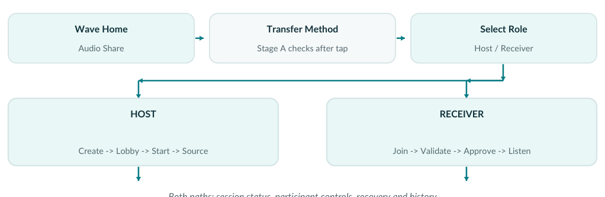
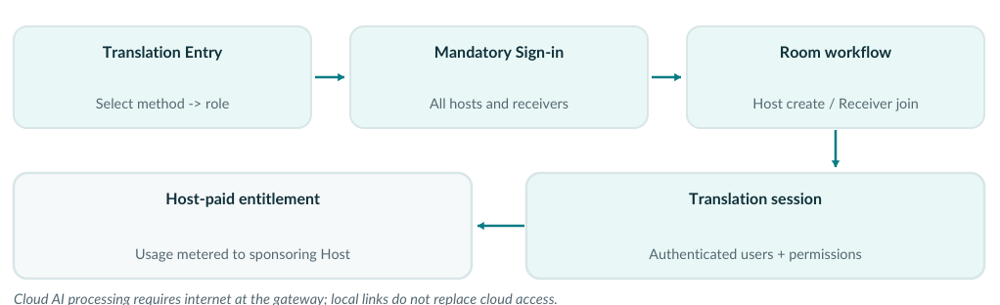

# Wave BRD — 06 Core user journeys

**From:** `01_BRD_Wave_Business_Requirements_Document_BRD_v1.0.pdf`  
**Pages:** 8  
**Status:** Source working draft; no claim of implemented completion.

## 06 Core user journeys

### 6.1 Audio Share - approved navigation

**Source diagram (page 8):** Audio Share navigation flow

Wave Home

Transfer Method

Select Role

Audio Share

Stage A checks after tap

Host / Receiver

HOST

RECEIVER

Create -> Lobby -> Start -> Source

Join -> Validate -> Approve -> Listen

Both paths: session status, participant controls, recovery and history

Entry order: Home -> Audio Share -> Transfer Method -> automatic Stage A check -> Select Role -> silent role-aware Stage B checks -> Host/Receiver branch. Contextual network fix prompts are shown only when user action is necessary, including distinct Host/Receiver hotspot guidance.

Host: Create Session -> Lobby -> Start -> Live Host (Ready) -> choose Music / Video / External App Audio -> manage active session. Receiver: Join via Code / QR / technically supported Nearby -> validate room, network, identity, security and capacity -> conditional approval -> Live Receiver. Active sessions resume through Sessions Hub where state remains valid.

### 6.2 Live Translation - latest approved authentication rule

**Source diagram (page 8):** Live Translation sign-in and session flow

Translation Entry

Mandatory Sign-in

Room workflow

Select method -> role

All hosts and receivers

Host create / Receiver join

Host-paid entitlement

Translation session

Usage metered to sponsoring Host

Authenticated users + permissions

Cloud AI processing requires internet at the gateway; local links do not replace cloud access. The Live Translation entry must preserve transport selection before role selection. After role selection, all Hosts and Receivers must authenticate before creating or joining. Sign-in may be contextually presented within the relevant branch without adding an alternate Create/Join gateway at the feature entry. Exact registration fields and screen placement are pending UX specification.

### 6.3 Sessions and lifecycle

Sessions Hub distinguishes active, reconnecting and ended/recent sessions. Reentering a valid active session should restore that role's live screen without unnecessary room recreation. A completed session is history unless an explicit restart feature is later designed. Host End is global; Receiver Leave affects only that receiver.
