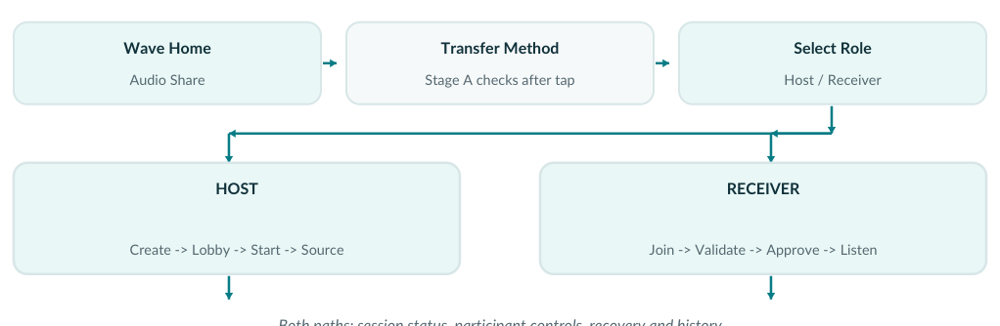
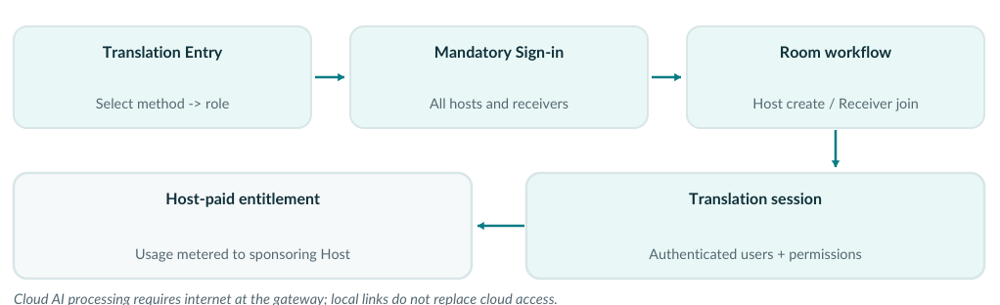

# Wave — Business Requirements Document

**Brand:** ZAEROX  
**Product:** Wave — Real-Time Translation & Multi-Device Audio Sharing  
**Source:** `01_BRD_Wave_Business_Requirements_Document_BRD_v1.0.pdf`  
**Source version:** 1.0 (Working Draft, 16 November 2026)  
**Conversion:** Markdown transcription of source PDF; source status and unresolved decisions unchanged.

## Original cover details

> ZAEROX  /  PRODUCT DOCUMENTATION

> WAVE

> BUSINESS REQUIREMENTS

> DOCUMENT

> Real-Time Translation &

> Multi-Device Audio Sharing

> DOCUMENT ID

> VERSION

> ISSUED

> ZAEROX-WAVE-BRD-001

> 1.0  /  DRAFT

> 16 NOV 2026

> Prepared for business and product stakeholder review

> Product requirements are not evidence of completed implementation or device certification.

## 00 Document control

| Field | Details |
| --- | --- |
| Document title | Business Requirements Document (BRD) |
| Project | Wave - Real-Time Translation & Multi-Device Audio Sharing |
| Brand / application label | ZAEROX / Wave |
| Reference | ZAEROX-WAVE-BRD-001 |
| Version / date | 1.0 / 16 November 2026 |
| Status | Working draft for review; not approved as final BRD |
| Primary platform | Android (Flutter application with native Android integrations) |
| Prepared for | Product owner, business stakeholders, UX, engineering, QA, security and operations |

### Purpose and interpretation

This BRD defines business outcomes, product scope, user roles, user journeys, rules, functional expectations, non-functional expectations, risks, acceptance direction and unresolved decisions for Wave. Detailed implementation choices belong in subsequent PRD, UX, architecture, API, security and test documents.

Decision precedence. The latest approved Wave decision requires every Live Translation participant (Host and Receiver) to sign in, including receivers in Host-paid sessions. Earlier concept drafts permitting translation guests are superseded. Basic Audio Share retains the guest/free-access direction.

### Revision notes

| Revision | Date | Summary |
| --- | --- | --- |
| 1.0 | 16 Nov 2026 | First structured business requirements baseline compiled from previous Wave discussions and UX decision handoffs; incorporated mandatory Live Translation sign-in rule. |

### Status legend

| Label | Meaning |
| --- | --- |
| Approved requirement | A product or UX rule the user has explicitly approved; implementation may be incomplete. |
| Engineering target | Desired outcome requiring design, validation and real-device evidence. |
| Open decision | Business, delivery, or technical detail not yet approved or specified. |
| Future concept | Considered for later release; excluded from baseline delivery unless separately approved. |

## Contents

00 Document control

2

01 Executive summary

4

02 Background, opportunity and problem statement

4

03 Business vision, principles and objectives

5

04 Project scope and boundaries

6

05 Stakeholders, customer groups and product roles

7

06 Core user journeys

8

07 Business requirements register

9

08 Detailed functional requirements

10

09 Business rules and policy decisions

13

10 Non-functional business requirements

14

11 Commercial model and operational economics

15

12 Data, identity, privacy and trust

15

13 Technical constraints and dependencies - business impact

16

14 Acceptance criteria and validation plan

17

15 Risks and response plan

18

16 Delivery approach and implementation evidence

18

17 Open decision register

19

18 Glossary

20

19 Approval and sign-off

20

Navigation: numbered sections follow business requirements document structure. Requirement IDs are stable draft references and can be reused in future PRDs, user stories and UAT cases.

## 01 Executive summary

Wave is a software-first Android product by ZAEROX intended to connect ordinary smartphones for synchronized local audio sharing and AI-assisted multilingual communication. It combines an offline-capable local Audio Share experience with a cloud-powered paid Live Translation experience under a shared app, session and connectivity model.

The business opportunity is to remove the need for dedicated audio-sharing hardware in common listening scenarios, while reducing communication barriers for education, travel, events and group discussions. Wave should work across appropriate Wi-Fi, mobile hotspot and Bluetooth-based transports, with a longer-term adaptive phone-to-phone relay capability.

### The two product pillars

| Audio Share | Live Translation |
| --- | --- |
| Free local audio-sharing direction for music, imported movie audio and permitted external-app playback. | Paid real-time translated voice and captions for one-to-many communication and approved group discussion. |
| Host controls the common timeline; receivers have independent local audio controls. | All participants sign in. The sponsoring Host owns the billable usage for Host-paid sessions. |
| Internet not required for eligible local transport and local playback. | Internet required at the AI translation gateway; local distribution is a separate concern. |

### Business position

Wave is a planned commercial product, not a claim that the complete feature set is shipped. Several Flutter prototype/source versions exist and targeted experiments have been performed, but synchronized operation across heterogeneous Android devices, large-group capacity, resilient multi-hop Bluetooth relay, and integrated live AI translation have not been certified for production.

## 02 Background, opportunity and problem statement

### Business problems

| ID | Problem | Wave response |
| --- | --- | --- |
| P-01 | Audio sharing to multiple nearby phones is inconsistent across device and vendor ecosystems. | Local group sessions with Host/Receiver access over supported wireless transports. |
| P-02 | Small playback timing differences cause echo and poor shared-listening experiences. | A transport-aware synchronization capability with rejoin and recovery. |
| P-03 | Language differences restrict participation in seminars, tourism and meetings. | Continuous translated voice and captions in selected supported languages. |
| P-04 | Venues may lack shared Wi-Fi, dedicated equipment or reliable local coverage. | Support router Wi-Fi, Host hotspot and approved local relay strategies. |
| P-05 | Cloud AI services create usage-based operating costs and abuse risk. | Authenticated translation, payer entitlements, metering, quotas and cost controls. |

### Target opportunity

The initial proposition is intended to be accessible to students, friends, educators, trainers, guides and organizers, including budget-sensitive users in Sri Lanka. It should let groups use existing compatible Android phones while offering a paid multilingual service with transparent usage limits and sustainable unit economics. No market-size, sales, or conversion estimates are approved in this BRD.

## 03 Business vision, principles and objectives

### Vision

Vision: Make shared listening and cross-language group communication easier and more affordable by transforming existing smartphones into connected audio receivers, speakers and translation participants.

### Product principles

- Software-first: core Wave access should not require ZAEROX earbuds or a separate BT SHARE transmitter.

- Simple entry: transport first, role second, then contextual Host/Receiver actions; avoid redundant setup screens.

- Truthful operation: never display successful sharing, connectivity or performance that is not actually available.

- Host control with receiver independence: shared session governance does not prevent local listening preferences.

- Privacy and cost awareness: microphone/cloud consent, protected identities, predictable AI billing and minimal data.

- Measured claims: capacity, latency, range and background behavior must be validated before external promises.

### Business objective register

| ID | Objective | Evidence / success direction |
| --- | --- | --- |
| OBJ-01 | Enable practical local Audio Share without mandatory mobile internet. | Multi-device UAT across supported Wi-Fi, hotspot and Bluetooth configurations. |
| OBJ-02 | Provide a coherent shared-listening experience. | Measured receiver sync, playback recovery and movie audio alignment. |
| OBJ-03 | Offer accessible multilingual listening and discussion. | Real session UAT for voice, captions, target language choice and speaker controls. |
| OBJ-04 | Maintain usable Host and Receiver workflows. | Completion rate for create, join, recover and leave scenarios. |
| OBJ-05 | Establish a sustainable paid translation business. | Metered cost vs revenue, entitlement success, quota enforcement and payer clarity. |
| OBJ-06 | Protect user trust and session security. | Authorized admission, secure transport, privacy notices and misuse testing. |
| OBJ-07 | Prepare Wave for scale without overpromising. | Device and network compatibility matrix supported by repeatable tests. |

## 04 Project scope and boundaries

### Baseline product scope - included

| Area | In-scope business capability |
| --- | --- |
| Core application | Android Wave application, Home, Audio Share, Live Translation, Sessions, contextual permissions and settings necessary to operate. |
| Audio Share | Host/Receiver group sessions; Music, Host Video audio only, eligible External App Audio; receiver output controls and session lifecycle. |
| Connectivity | User selection of Wi-Fi, Mobile Hotspot or Bluetooth; discovery/joining via supported code, QR and Nearby methods; readiness/recovery. |
| Relay & sync | Dynamic forwarding and synchronized delivery as engineering targets; not a capacity or performance guarantee. |
| Live Translation | Authenticated participants; voice + captions; continuous one-to-many use case; authorized group discussion as a product goal. |
| Commercial | Host-paid session entitlement, billable AI usage controls, quotas, subscription/credit modeling and payment integration requirements. |
| Trust | Consent, identity verification, protected sessions, participant moderation, basic privacy and audit/diagnostic needs. |

### Not in baseline scope

- Manufacture, sale, or operation of proprietary ZAEROX earbuds or physical BT SHARE hardware as a dependency.

- Receiver-side movie/video streaming or a Watch Together video screen: receivers listen to Host movie audio only.

- A separate microphone audio source under Audio Share; microphones belong to Live Translation.

- Guaranteed capture from every third-party media app; Android and source-app policies govern eligibility.

- Fully offline AI speech translation; the approved approach relies on internet-accessible AI processing.

- General cloud-hosted cross-network room discovery/participation as a default local-session capability.

- Guaranteed unlimited recipients, seamless all-device mesh operation, zero latency, or universal Android support.

### Future / independently scoped options

Theater Mode with channel-specific surround roles, placement, calibration and fallback is a separate approved future concept and is not inserted into the baseline Audio Share screen count. Consented personal voice cloning, broader language coverage, advanced multi-session translation and other expansion ideas require their own product prioritization.

## 05 Stakeholders, customer groups and product roles

### Stakeholders

| Stakeholder | Interest / responsibility |
| --- | --- |
| ZAEROX product ownership | Business outcomes, requirement approval, scope, pricing, go/no-go and priorities. |
| Product design / UX | Consistent screens and accessibility without altering approved Wave component language. |
| Flutter / Android engineering | Client workflows, native permissions, transport integration, media and sync behavior. |
| AI / cloud engineering | Translation gateway, streaming, cost usage and language/provider support. |
| Security / privacy / operations | Identity, protected rooms, retention, payments, monitoring and incident response. |
| Quality assurance / real users | Functional acceptance, device compatibility, network/recovery testing and usability. |

### Personas and role permissions

| Role | Meaning | Key rights / limits |
| --- | --- | --- |
| Audio Share Host | Starts and manages a local audio session. | Create room, configure approvals, invite, select source, global playback controls, remove participants and end session; guest mode is permitted. |
| Audio Share Receiver | Joins a local audio session. | Listen, local pause/mute/volume/output/leave; cannot end or globally control other devices; guest mode is permitted. |
| Translation Host | Authenticated creator/payer of a translation room. | Create and manage paid session, select relevant options, manage speaker rights and usage; must have valid payer entitlement. |
| Translation Receiver | Authenticated participant in a translation room. | Join, select language, receive voice/captions, speak only if authorized; no separate charge in Host-sponsored model. |
| Relay device | Automatic network responsibility, not a signup role. | May listen and forward within supported connectivity and session permissions; user still selects Host or Receiver. |

## 06 Core user journeys

### 6.1 Audio Share - approved navigation

**Source diagram (page 8):** Audio Share navigation flow

Wave Home

Transfer Method

Select Role

Audio Share

Stage A checks after tap

Host / Receiver

HOST

RECEIVER

Create -> Lobby -> Start -> Source

Join -> Validate -> Approve -> Listen

Both paths: session status, participant controls, recovery and history

Entry order: Home -> Audio Share -> Transfer Method -> automatic Stage A check -> Select Role -> silent role-aware Stage B checks -> Host/Receiver branch. Contextual network fix prompts are shown only when user action is necessary, including distinct Host/Receiver hotspot guidance.

Host: Create Session -> Lobby -> Start -> Live Host (Ready) -> choose Music / Video / External App Audio -> manage active session. Receiver: Join via Code / QR / technically supported Nearby -> validate room, network, identity, security and capacity -> conditional approval -> Live Receiver. Active sessions resume through Sessions Hub where state remains valid.

### 6.2 Live Translation - latest approved authentication rule

**Source diagram (page 8):** Live Translation sign-in and session flow

Translation Entry

Mandatory Sign-in

Room workflow

Select method -> role

All hosts and receivers

Host create / Receiver join

Host-paid entitlement

Translation session

Usage metered to sponsoring Host

Authenticated users + permissions

Cloud AI processing requires internet at the gateway; local links do not replace cloud access. The Live Translation entry must preserve transport selection before role selection. After role selection, all Hosts and Receivers must authenticate before creating or joining. Sign-in may be contextually presented within the relevant branch without adding an alternate Create/Join gateway at the feature entry. Exact registration fields and screen placement are pending UX specification.

### 6.3 Sessions and lifecycle

Sessions Hub distinguishes active, reconnecting and ended/recent sessions. Reentering a valid active session should restore that role's live screen without unnecessary room recreation. A completed session is history unless an explicit restart feature is later designed. Host End is global; Receiver Leave affects only that receiver.

## 07 Business requirements register

Business requirements state the organizational need independent of exact implementation. Priority is Must, Should, or Future; a priority is not evidence of implemented software.

| ID | Priority | Business requirement |
| --- | --- | --- |
| BR-01 | Must | Deliver two distinct services in one Wave app: local Audio Share and paid cloud-powered Live Translation. |
| BR-02 | Must | Make eligible Audio Share operations usable without mandatory internet or external hardware. |
| BR-03 | Must | Enable a Host to manage an audio-sharing session while receivers control their own listening behavior. |
| BR-04 | Must | Restrict Audio Share sources to Music, Host Video audio and permitted External App Audio. |
| BR-05 | Must | Provide Wi-Fi, Mobile Hotspot and Bluetooth transfer choices before role selection. |
| BR-06 | Must | Protect room access through verified admission, supported invitation mechanisms and Host approval policy. |
| BR-07 | Must | Require every participant in a Live Translation room to sign in, whether payer or sponsored receiver. |
| BR-08 | Must | Enable Host-sponsored translation where one verified Host funds authorized group usage. |
| BR-09 | Must | Provide translated voice and captions in participant-selected supported languages. |
| BR-10 | Must | Meter AI usage and enforce entitlement, quota and anti-abuse controls. |
| BR-11 | Should | Support authorized multilingual discussion, not only one-way delivery. |
| BR-12 | Should | Support resilient recovery from foreseeable disconnects and app background transitions. |
| BR-13 | Should | Pursue adaptive local relaying and accurate audio synchronization based on tested capabilities. |
| BR-14 | Must | Make privacy, data usage, permissions and security requirements clear to users. |
| BR-15 | Must | Separate approved experience decisions from product goals not yet physically validated. |
| BR-16 | Future | Evaluate Theater Mode, personal voice options and other expansion separately from baseline. |

## 08 Detailed functional requirements

This section captures what the Wave product must do, while avoiding hard-coded assumptions about transport, API provider or exact capacity. Each entry is a requirement/target, not a claim of present implementation.

### 8.1 Shared app and session management

| ID | Priority | Requirement |
| --- | --- | --- |
| FR-C01 | Must | Show Wave Home with Audio Share, Live Translation and genuine active-session resume entry. |
| FR-C02 | Must | Provide method selection in this order: Wi-Fi, Bluetooth, Mobile Hotspot (UI presentation may follow locked design). |
| FR-C03 | Must | Run automatic method capability checks and role-specific checks; show compact fix prompt only if required. |
| FR-C04 | Must | Provide Host and Receiver roles; do not expose Relay as a third role tile. |
| FR-C05 | Must | Provide Sessions Hub with Hosted / Joined, Active / Reconnecting / Recent states. |
| FR-C06 | Must | Reopen a valid active session without forcing a new create/join operation. |
| FR-C07 | Must | Represent Ready, Active, Paused, Reconnecting, Unavailable and Ended states honestly. |
| FR-C08 | Must | Handle Android permission denial, retry, limited hardware support and settings return. |
| FR-C09 | Should | Provide clear connection diagnostics, error messages and recovery/leave paths. |

### 8.2 Audio Share - Host and Receiver

| ID | Priority | Requirement |
| --- | --- | --- |
| FR-A01 | Must | Allow a Host to define room name, supported participant capacity and Join Approval setting. |
| FR-A02 | Must | Provide an invite mechanism with QR and room code; Nearby only when actually supported. |
| FR-A03 | Must | Validate room reachability, identity/authorization, session state and capacity before admitting a Receiver. |
| FR-A04 | Must | When approval is ON, support request, waiting, accept, reject, timeout and cancel; OFF bypasses manual approval but not security checks. |
| FR-A05 | Must | Let Host start from Lobby into Live Host Ready before choosing an audio source. |
| FR-A06 | Must | Provide exactly Music, Video, External App Audio source selections; exclude Microphone. |
| FR-A07 | Must | Enable local music import/playback and Host global play/pause/seek controls when supported. |
| FR-A08 | Must | Let Host import and view video locally while distributing its audio only to Receivers. |
| FR-A09 | Must | On Host leaving video player or locking screen, pause local video and shared movie audio but preserve the session. |
| FR-A10 | Must | For supported sources only, obtain platform consent to capture external-app playback audio and report capture states. |
| FR-A11 | Must | Let Receiver choose local audio output, adjust volume/mute, pause/resume output and leave independently. |
| FR-A12 | Must | Receiver-local pause shall not stop others or required relay forwarding; resume should rejoin current Host timeline. |
| FR-A13 | Must | Host global pause/end shall update the shared session; Host End terminates the room for all participants. |
| FR-A14 | Should | Keep eligible shared music active during supported minimized/screen-off conditions. |
| FR-A15 | Should | Provide source switching without destroying session identity and safely release old source resources. |
| FR-A16 | Target | Implement timestamped synchronized playback, drift correction and fast rejoin across supported transports. |
| FR-A17 | Target | Support adaptive direct / multi-hop / branching local forwarding and route repair where technically feasible. |
| FR-A18 | Target | Investigate transport transitions without unnecessary session loss; treat reachability and capability as conditional. |

### 8.3 Live Translation and language experience

| ID | Priority | Requirement |
| --- | --- | --- |
| FR-T01 | Must | Preserve transfer method selection -> role selection before Live Translation Host/Receiver actions. |
| FR-T02 | Must | Require successful account sign-in for all Live Translation participants before creating or joining rooms. |
| FR-T03 | Must | Permit authenticated Host to create and manage an eligible translation session after entitlement validation. |
| FR-T04 | Must | Permit authenticated Receivers to join authorized Host-sponsored sessions without individual payment. |
| FR-T05 | Must | Allow each participant to select a supported listening/translation language. |
| FR-T06 | Must | Capture authorized speaker microphone audio with appropriate permissions and send it to a valid translation gateway. |
| FR-T07 | Must | Provide translated synthesized voice and live captions for eligible target languages. |
| FR-T08 | Must | Keep translation output updated during ongoing speech, including interruption and reconnect scenarios. |
| FR-T09 | Should | Allow Host to approve/manage which participants can speak during multilingual discussion. |
| FR-T10 | Should | Support bidirectional discussion and avoid uncontrolled overlapping-speaker usage. |
| FR-T11 | Target | Explore grouping repeated translation computation per language/stream where possible to control cost. |
| FR-T12 | Target | Explore multiple parallel multilingual sessions/channels as a scaling capability. |
| FR-T13 | Must | Show internet/service outage, unavailable language or denied microphone states accurately. |
| FR-T14 | Future | Support consent-based own-voice output only after separate review of privacy, quality and cost. |

### 8.4 Identity, payment, usage and governance

| ID | Priority | Requirement |
| --- | --- | --- |
| FR-I01 | Must | Allow guest-style access to basic Audio Share independent of Live Translation account requirement. |
| FR-I02 | Must | Require Live Translation account identity for Host and Receiver, including Host-paid invitees. |
| FR-I03 | Must | Ensure Receiver sign-in does not imply they need their own paid subscription in a sponsored session. |
| FR-I04 | Must | Validate Host subscription/credits/entitlement before beginning billable operations. |
| FR-I05 | Must | Attribute authorized speaker/session translation usage to the sponsoring Host in Host-paid mode. |
| FR-I06 | Must | Meter usage according to the chosen AI provider charging units and agreed billable policy. |
| FR-I07 | Must | Block unauthorized chargeable actions and enforce configurable limits and session budgets. |
| FR-I08 | Should | Provide Host-visible usage estimates, consumption status, warnings and stop/renewal state. |
| FR-I09 | Must | Keep payment-sensitive card or account credentials out of Wave application records; use approved processors. |
| FR-I10 | Open | Specify registration fields, exact checkout screens, local currency, subscription duration, refund and tax rules. |

## 09 Business rules and policy decisions

| ID | Rule |
| --- | --- |
| POL-01 | Wave app icon/installed title and in-app product name must be exactly "Wave"; ZAEROX is the brand. |
| POL-02 | Audio Share uses Guest/Free entry; Live Translation has no guest participation. |
| POL-03 | All translation participants must authenticate, regardless of whether the Host sponsors their usage. |
| POL-04 | In Host-paid translation, only the sponsoring Host is the designated payer for authorized group AI usage. |
| POL-05 | Audio Share offers Host and Receiver only; relay is internal behavior. |
| POL-06 | Transport is chosen before role for both main service flows. |
| POL-07 | Audio Share has three Host sources only; microphone is not an Audio Share source. |
| POL-08 | Host controls global media playback and room termination; Receiver-local controls do not affect other users. |
| POL-09 | Movie video remains on Host only. Minimizing Host video pauses movie video and shared movie audio. |
| POL-10 | Join Approval ON uses host authorization; OFF still requires security and capacity validation. |
| POL-11 | A short room code discovers a session; it is not, by itself, adequate authentication. |
| POL-12 | One Receiver leaving does not end the session; Host End affects everyone. |

| ID | Rule |
| --- | --- |
| POL-13 | Active session may be resumed; ended session is history unless explicit restart is separately approved. |
| POL-14 | Audio Share source capture is limited to eligible platforms/apps; no promise of universal capture. |
| POL-15 | No unsupported claims about unlimited phones, precise range, synchronization or translation latency. |
| POL-16 | Core Live Translation processing requires internet at its AI gateway; local Audio Share does not. |

## 10 Non-functional business requirements

Values below are product expectations and testing directions. Where no baseline or thresholds have been approved, acceptance thresholds must be agreed after representative device and service benchmarking.

| ID | Quality area | Business expectation |
| --- | --- | --- |
| NFR-01 | Availability | Recover gracefully from recoverable network/service interruption; show true status and actions. |
| NFR-02 | Audio synchronization | Measure receiver-to-receiver and Host-video alignment by transport/device; earlier 10-20 ms figure is a research target, not a guarantee. |
| NFR-03 | Translation latency | Work toward approximately 1-2 s perceived continuous translated speech in early stages; sub-500 ms is a later research ambition only. |
| NFR-04 | Scalability | Verify capacity separately for Wi-Fi, hotspot, direct Bluetooth and relay; no universal max count. |
| NFR-05 | Security | Protect identity, session membership, speaking permissions and billing access; document cryptography and key handling. |
| NFR-06 | Privacy | Apply data minimization, consent/notice for microphone and cloud processing, and defined retention/deletion policies. |
| NFR-07 | Reliability | Handle packet loss, buffering, clock drift, host exit, screen lock, device sleep, reconnect and audio-route changes. |
| NFR-08 | Accessibility | Follow approved contrast corrections and test Android touch targets, font scaling, screen readers and reduced motion. |
| NFR-09 | Compatibility | Maintain a tested Android OS and device/OEM support matrix before public support claims. |
| NFR-10 | Cost efficiency | Track cost per translation minute/target language/session and implement usage caps/alerts. |
| NFR-11 | Observability | Provide useful diagnostics and redacted network/error logs without unnecessary personal content. |
| NFR-12 | Media quality | Use appropriate codec/quality settings; tune against measured conditions rather than marketing targets. |

## 11 Commercial model and operational economics

### Service tiers - current direction

| Service | Access | Payer / charging |
| --- | --- | --- |
| Basic Audio Share | Free/guest path for local audio features. | No cloud translation fee; network/device operational constraints remain. |
| Live Translation - Host-sponsored | All Host/Receiver participants authenticate; Host must have valid paid entitlement. | Host funds authorized session translation usage; receivers do not pay individually for that session. |
| Alternative individual-paid offering | Explored concept; not locked as launch pricing/packaging. | Requires separate approved payer and entitlement rules if implemented. |

### Billing policy design needs

- Establish the billable usage basis from the chosen provider (time, audio tokens or other units); do not assume one uniform per-minute price.

- Define whether source audio, each target language, speech output and caption processing have separate cost drivers.

- Prevent one authorized participant from unintentionally spending beyond Host-defined limits.

- Present pre-session entitlement and usable balance, in-session usage state and clear exhaustion/renewal behavior.

- Measure per-session revenue, AI cost, payment fees, infrastructure overhead, gross margin and abuse/fraud events.

- Specify cancellation, payment disputes, refunds, taxes, currencies and legal terms before production checkout.

Not finalized: subscription price, credit conversion, included minutes, number of languages per plan, payment provider, taxes, trial duration and per-user limits. Informal cost calculations from exploratory chats are not commercial approvals.

## 12 Data, identity, privacy and trust

### Proposed minimal business data categories

| Category | Purpose | Status |
| --- | --- | --- |
| Account identity / credentials | Authenticate every Live Translation Host and Receiver; perform recovery and abuse prevention. | Specific fields and identity provider open. |
| Session metadata | Identify room, host, membership, method, status, invite and role. | Needed for approved journeys. |
| Authorization state | Manage join approval, speaker permission, removal and sponsored-session entitlement. | Required rule. |
| Usage and commerce metadata | Associate billable AI consumption and entitlement with sponsoring Host. | Required; detailed schema open. |
| Diagnostics | Support reliability/security troubleshooting with privacy safeguards. | Scope and retention open. |
| Speech and captions | Process authorized live translation streams. | Retention and recording policy open. |

### Privacy constraints

Wave must explain when audio is captured locally, when speech or text is transmitted to a cloud AI provider, and who can hear output within a session. Define retention and deletion periods, geographic handling, consent for any optional recording or voice cloning, and participant rights. No always-on recording or archival of translated speech should be assumed as part of the baseline requirement.

Password storage, account recovery, account deletion, processor-hosted payments, and regulatory/legal review need detailed requirements before production release. Do not store users' card numbers, CVV or banking PIN in Wave.

## 13 Technical constraints and dependencies - business impact

| Dependency / constraint | Why it matters | Required response |
| --- | --- | --- |
| Android app/platform permissions | Bluetooth, nearby device discovery, hotspot, camera, microphone, background processes and media capture vary by OS/OEM. | Contextual permission workflow; tested compatibility matrix. |
| Wi-Fi / hotspot topology | Available bandwidth, interference, AP client limits and local discovery affect group size. | Measured limits and capacity-aware messaging. |
| Bluetooth multi-hop | Classic Bluetooth, BLE and OEM restrictions affect fanout and concurrent audio operations. | Feasibility test, routing limits and alternatives; no automatic-mesh claim. |
| Media synchronization | Clock drift, jitter, buffering and output-route latency cause echo/lip-sync problems. | Playback Sync Engine benchmark and fallback paths. |
| External-app playback capture | Source applications may opt out of capture; platform consent is mandatory. | Eligible-app feedback and supported-case tests. |
| AI cloud provider | Streaming language support, latency, pricing, quotas and data terms vary. | Provider evaluation with accuracy, privacy and unit economics. |

| Dependency / constraint | Why it matters | Required response |
| --- | --- | --- |
| Internet gateway | Even local Receiver access requires a route to cloud AI for translation. | Define gateway availability/connection requirements and outage behavior. |

## 14 Acceptance criteria and validation plan

Final release gates require recorded test environments, pass/fail evidence and stakeholder-approved thresholds. Suggested UAT cases below are suitable for conversion into executable QA scenarios; they are not completed test results.

| ID | Area | Acceptance scenario |
| --- | --- | --- |
| UAT-01 | Audio Share | Host starts valid room on supported local method and Receiver joins with correct approvals; no internet required for local media. |
| UAT-02 | Audio Share | Host selects local music; multiple phones play shared audio; pause/seek behavior matches global/local rule. |
| UAT-03 | Audio Share | Host plays imported video and receivers hear audio only; leave player pauses movie video and audio while keeping room alive. |
| UAT-04 | Audio Share | Receiver pauses locally and resumes at current timeline without interrupting other listeners/necessary forwarding. |
| UAT-05 | Audio Share | Denied Bluetooth/camera/capture permission shows relevant action, does not falsely report ready. |
| UAT-06 | Audio Share | Unsupported third-party audio capture reports eligibility/permission state instead of promising playback. |
| UAT-07 | Session | Active session resume returns to live view; ended session displays historical details, not misleading Resume. |
| UAT-08 | Translation | Host and Receiver are both blocked from create/join until signed in, including sponsored receiver. |
| UAT-09 | Translation | Eligible Host can begin a funded session; Receiver can join without personal charge. |
| UAT-10 | Translation | Authorized speech produces selected language voice and captions; failed/unavailable language reported. |
| UAT-11 | Billing | Authorized usage is attributed to sponsoring Host; quota exhaustion prevents unexpected charge. |
| UAT-12 | Resilience | Measure transport-specific latency, audio drift, capacity, recovery and background behavior on defined devices. |

### Minimum evidence for release sign-off

- Approved requirements-to-test traceability and defect log with severity and owner.

- Device/OS matrix and test conditions for every published network/capacity/performance claim.

- Security, privacy, payments and entitlement controls reviewed before paid translation release.

- End-to-end bilingual translation samples with target-language and speaker-rights coverage.

- User acceptance of approved Wave visual identity, navigation and accessible interaction behavior.

## 15 Risks and response plan

| ID | Severity | Risk / uncertainty | Mitigation |
| --- | --- | --- | --- |
| RISK-01 | High | Bluetooth adaptive relay may not be practical across diverse phones. | Prove capabilities on devices; gate or limit claims; retain Wi-Fi/hotspot alternatives. |
| RISK-02 | High | Latency/jitter prevents convincing synchronized music/movie audio. | Define Sync Engine acceptance thresholds and benchmark multiple devices. |
| RISK-03 | High | AI usage grows faster than subscriptions or quota guardrails. | Host-funded quotas, metering, concurrency controls and cost dashboards. |
| RISK-04 | High | Third-party capture unavailable on some Android apps. | Restrict eligibility claims and test consent/opt-out scenarios. |
| RISK-05 | High | Identity/room or payment authorization compromise. | Independent security reviews; secure join and server-side entitlement. |
| RISK-06 | Med | Translation provider limitations affect Tamil or other languages. | Benchmark providers, speech quality and streaming support before locking roadmap. |
| RISK-07 | Med | Hotspot/client capacity varies by OEM or venue. | Publish measured device-specific capacity guidance. |
| RISK-08 | Med | Background services die under battery policies. | OEM testing and documented user recovery paths. |
| RISK-09 | Med | Unapproved claims appear in marketing or partner documents. | Attach product decision status and test evidence to release material. |
| RISK-10 | Med | Privacy complaints from live speech capture or cloud transfer. | Transparent consent, retention policy and opt-out/exit actions. |

## 16 Delivery approach and implementation evidence

### Suggested release workstreams (planning proposal, not approved schedule)

| Workstream | Desired outcome | Exit evidence |
| --- | --- | --- |
| A - Foundation | Reliable Wave Home, transport selection, Host/Receiver rooms, Audio Share basic session controls. | Stable multi-phone UAT; secure joining. |
| B - Media and synchronization | Music/video/external source paths; local Receiver independence; measured audio sync. | Real-device sync/recovery benchmark. |
| C - Relay and resilience | Transport-specific discovery, adaptive forwarding, room continuity and background operation. | Network topology and OEM reliability tests. |
| D - Translation platform | Mandatory accounts, language pipeline, speech/captions and authorized group discussion. | End-to-end bilingual and access-control UAT. |
| E - Commercial readiness | Host entitlements, usage metering, quotas, payment, privacy and operational monitoring. | Payment sandbox, cost and security sign-off. |

### Current known evidence status

Multiple Wave Android/Flutter source archives and earlier phone experiments exist. Available UX documentation fixes the 19-screen Audio Share navigation and important behavior, but notes that those design decisions are not proof of final code integration. Bluetooth mesh scale, Sync Engine results, third-party capture, battery/background resilience, final authentication UI and live AI integration require further verification. A production readiness claim should be based on a current repository audit and repeatable device tests, not document approval.

## 17 Open decision register

| ID | Decision required |
| --- | --- |
| OD-01 | Launch country/market sequence and exact primary customer segment. |
| OD-02 | Official supported Android versions, OEMs, devices and screen minimums. |
| OD-03 | First production translation language list (English/Tamil has prototype precedence only). |
| OD-04 | Production AI/speech vendor, service architecture, accuracy/latency thresholds and cloud region. |
| OD-05 | Translation subscription types, prices, currencies, trials, quotas and credit semantics. |
| OD-06 | Checkout/payment provider, tax, refunds, cancellation and renewal policies. |
| OD-07 | Mandatory account fields, sign-in provider, verification and exact branch-level UI placement. |
| OD-08 | Account/data retention, deletion, recording policy and consent wording. |
| OD-09 | Formal audio sync/quality/latency targets and objective release thresholds per transport. |
| OD-10 | Supported participant limits and relay depth measured separately for hardware/network combinations. |
| OD-11 | How to handle Host lost connection, host election, session ownership transfer and re-authentication. |
| OD-12 | Cross-transport room migration and unsupported-transport fallback policy. |
| OD-13 | Source media permissions, format list, copyright and external-app support documentation. |
| OD-14 | Live Translation parallel rooms, speaker-concurrency policy and maximum live participants. |
| OD-15 | Host sponsor budget display, exhaust state and authorized speaker spending constraints. |
| OD-16 | Future Theater Mode scope, feasibility and release priority. |

## 18 Glossary

| Term | Definition |
| --- | --- |
| Host | Session creator/controller; may be sponsoring payer in Live Translation. |
| Receiver | Joined listener with independent local listening controls; may speak only if authorized in translation. |
| Relay | A device forwarding eligible traffic to extend local coverage; not a visible user role. |
| Room / Session | A managed group context with identity, membership, status and shared audio/translation behavior. |
| Sync Engine | Proposed mechanisms aligning playback clocks/timelines and correcting drift, jitter and recovery. |
| A2DP | Bluetooth audio distribution profile; not a universal multi-phone broadcasting mechanism. |
| Captions | Text presentation of recognized/translated speech during a session. |
| Entitlement | Server-verified permission to consume a paid service under a subscription or credit policy. |
| AI Gateway | Internet-connected translation processing layer consuming authorized speech and returning output. |
| UAT | User Acceptance Testing: observed evidence that approved behavior satisfies test scenarios. |

## 19 Approval and sign-off

This version is intended for review. Approval should confirm that the business requirements describe the intended Wave product and that open decisions remain visible rather than silently treated as finished.

| Approval role | Name / signature | Date |
| --- | --- | --- |
| Product owner | ________________________________________ | ______________ |
| Business / commercial owner | ________________________________________ | ______________ |
| Engineering lead | ________________________________________ | ______________ |
| UX / accessibility reviewer | ________________________________________ | ______________ |
| Security / privacy reviewer | ________________________________________ | ______________ |

Document boundary: Approving this BRD does not certify a working APK, synchronized media, relay topology, user capacity, AI translation provider, or live payment infrastructure. These require separate implementation and acceptance evidence.

Internal reference basis: Previous Wave product discussions and decisions through 16 November 2026; Wave Audio Share UX V3.1 Fixed Decisions handoff; Wave consolidated product concept. Latest explicit user decision controls conflicts, notably mandatory Live Translation sign-in.
