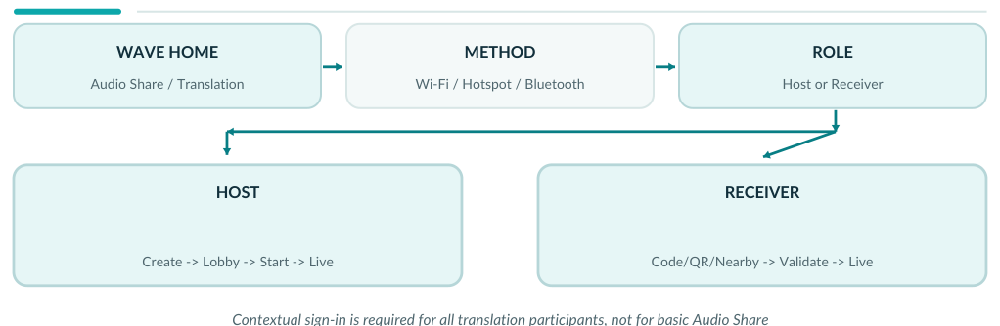

# Wave PRD — 04 Product navigation and entry conditions

**From:** `02_PRD_Wave_Product_Requirements_Document_PRD_v1.0.pdf`  
**Pages:** 5, 6  
**Status:** Source working draft; no claim of implemented completion.

## 04 Product navigation and entry conditions

**Source diagram (page 5):** Product navigation: method then role

WAVE HOME

METHOD

ROLE

Audio Share / Translation

Wi-Fi / Hotspot / Bluetooth

Host or Receiver

HOST

RECEIVER

Create -> Lobby -> Start -> Live

Code/QR/Nearby -> Validate -> Live

Contextual sign-in is required for all translation participants, not for basic Audio Share

The order is fixed: Feature entry -> choose Wi-Fi/Bluetooth/Hotspot -> Host or Receiver -> Create or Join. Live Translation authentication belongs contextually inside those existing branches. Do not replace the sequence with an unrelated Create/Join gateway.

### Shared navigation rules

- Wave Home exposes Audio Share and Live Translation as separate feature cards. Preserve current bottom navigation: Audio Share | Home | Sessions; do not add an unapproved bottom tab.

- Transfer method selection is a direct tap, without an additional Continue page. Stage A silently checks capability/permissions. After role selection, Stage B runs role-specific checks.

- Only missing permissions or connectivity actions trigger a compact contextual fix popup. Never show a mandatory success/setup page or falsely claim a connection is ready.

- Host chooses Create Session; Receiver chooses Join Session; a valid existing session is resumed from Sessions Hub in its current state.

- Relay behavior is invisible to the role selector: Host and Receiver are the only user-facing roles.

### Authentication entry rules

| Journey | Required account state | Expected behavior |
| --- | --- | --- |
| Audio Share / Host | Guest allowed | Can configure and create local session without mandatory sign-in. |
| Audio Share / Receiver | Guest allowed | Can enter code/scan QR; admission and nickname handling depend on session policy. |
| Live Translation / Host | Must sign in | Block funded session creation until verified account and entitlement are established. |
| Live Translation / Receiver | Must sign in | Block translation join until account authenticated, even if Host pays. |
