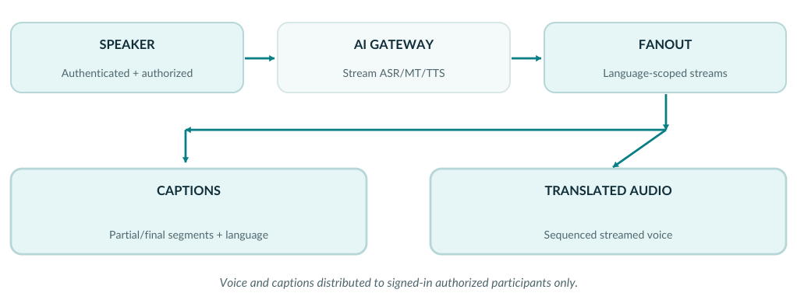

# Wave PRD — 08 Live Translation - product capabilities

**From:** `02_PRD_Wave_Product_Requirements_Document_PRD_v1.0.pdf`  
**Pages:** 10, 11  
**Status:** Source working draft; no claim of implemented completion.

## 08 Live Translation - product capabilities

**Source diagram (page 10):** Translation streaming and outputs

### One-to-many multilingual listening

A signed-in Host creates a translation session. All Receivers sign in, enter through the approved method -> role -> join path, select a supported language and hear generated translated speech alongside live captions. Voice and text must represent the correct speaker/language and expose true connection/translation status.

### Bidirectional multilingual group discussion

The Host can authorize additional speakers. A speaker may request permission, and authorized speaking produces translated output for the rest of the group. Moderator actions and source/speaker status must be visible. Simultaneous speaker and interruption policy remains a product/engineering detail to finalize.

### Parallel sessions and localization

Multiple concurrent multilingual rooms were identified as a use case, but concurrency/scale is not a verified release promise. English <-> Tamil is the prototype starting pair; the production launch language catalogue is not yet finalized. Model-generated voice comes first; optional consent-based voice cloning is future scope.

SPEAKER

AI GATEWAY

FANOUT

Authenticated + authorized

Stream ASR/MT/TTS

Language-scoped streams

CAPTIONS

TRANSLATED AUDIO

Partial/final segments + language

Sequenced streamed voice

Voice and captions distributed to signed-in authorized participants only.

### Live Translation requirements

| ID | Requirement | State |
| --- | --- | --- |
| PR-LT-01 | Require account sign-in for every Host and Receiver; do not allow guest translation access. | LOCKED |
| PR-LT-02 | Preserve method -> role -> Host create or Receiver join navigation with contextual sign-in. | LOCKED |
| PR-LT-03 | Validate Host paid entitlement before creating/starting a chargeable session. | LOCKED |
| PR-LT-04 | Receivers in Host-paid rooms need accounts but do not purchase a separate entitlement. | LOCKED |
| PR-LT-05 | Each listener chooses supported target language and receives translated voice + captions. | LOCKED + TARGET |
| PR-LT-06 | Only Host-authorized speakers may inject billable speech into the session. | LOCKED |
| PR-LT-07 | Show speech/listening/processing/reconnecting/quota/errors truthfully. | LOCKED + TARGET |
| PR-LT-08 | The app must be explicit when cloud connectivity is unavailable; do not claim offline translation. | LOCKED |
| PR-LT-09 | Support model voice initially; user voice cloning remains deferred. | LOCKED / FUTURE |
| PR-LT-10 | Evaluate multiple parallel language sessions only after provider/scale tests. | TARGET |
