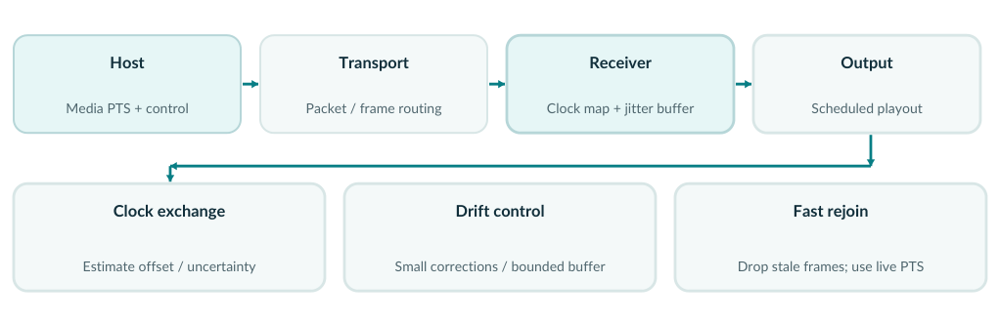

# Wave PRD — 10 Connectivity, relay and synchronization expectations

**From:** `02_PRD_Wave_Product_Requirements_Document_PRD_v1.0.pdf`  
**Pages:** 12  
**Status:** Source working draft; no claim of implemented completion.

## 10 Connectivity, relay and synchronization expectations

**Source diagram (page 12):** Proposed synchronization flow

### Selected methods and dependency rules

| Method | Audio Share experience | Translation caveat |
| --- | --- | --- |
| Wi-Fi | Local group distribution through a supported common LAN. | Cloud gateway still needs internet; Receiver sign-in requires an approved auth path. |
| Hotspot | Host hotspot forms local network without router; Android system setup may be required. | No internet is needed for local Audio Share; AI requires usable internet at a gateway. |
| Bluetooth | Direct and multi-hop app-level forwarding are engineering targets. | Translation audio/control fanout over Bluetooth must be demonstrated, not assumed. |

### World-class Sync Engine (target behavior)

Host

Transport

Receiver

Output

Media PTS + control

Packet / frame routing

Clock map + jitter buffer

Scheduled playout

Clock exchange

Drift control

Fast rejoin

Estimate offset / uncertainty

Small corrections / bounded buffer

Drop stale frames; use live PTS

- Keep Host clock/playback timeline authoritative; use timestamps, future playout scheduling, buffering and drift correction.

- Music synchronization must prioritize shared timing; movie audio must align with Host-visible video; external-app capture prioritizes lowest feasible latency.

- Local Receiver pause does not alter network forwarding; resume jumps to current live timeline and discards stale frames.

- Track latency, buffer occupancy, estimated offset, drift, underruns, loss and rejoin time in privacy-safe diagnostic metrics.

- 10-20 ms receiver-to-receiver synchronization and 1-2 s translated-audio lag were discussed as aspirations, NOT acceptance guarantees without measured device evidence.
