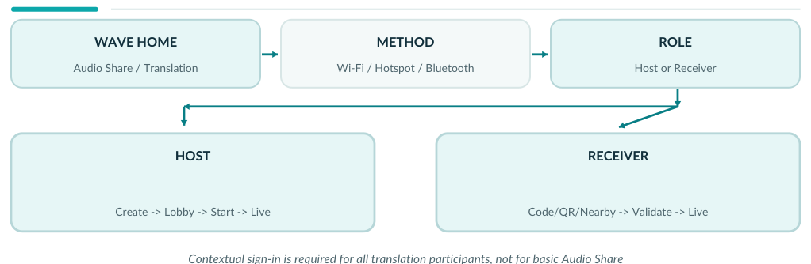
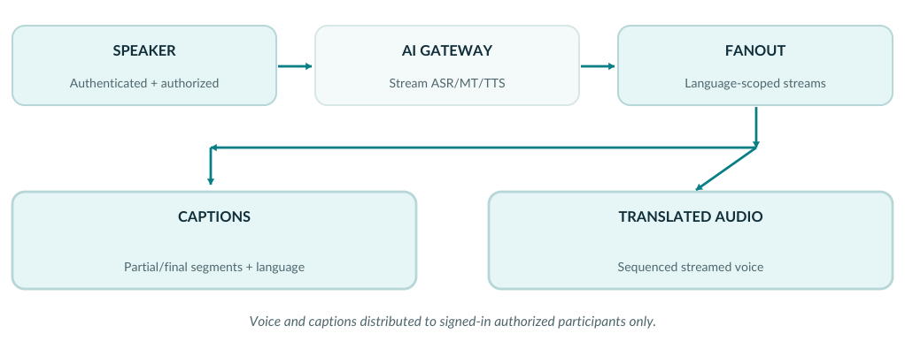
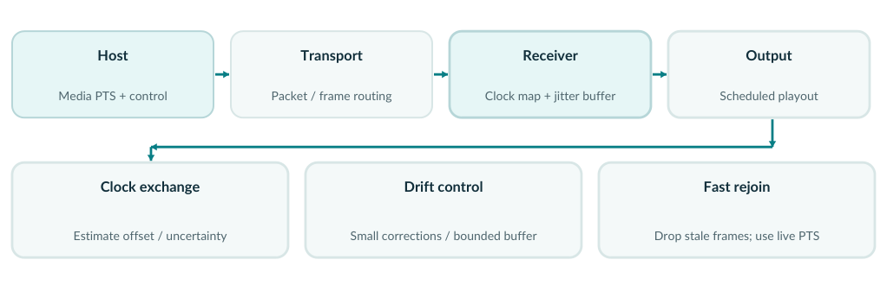

# Wave — Product Requirements Document

**Brand:** ZAEROX  
**Product:** Wave — Real-Time Translation & Multi-Device Audio Sharing  
**Source:** `02_PRD_Wave_Product_Requirements_Document_PRD_v1.0.pdf`  
**Source version:** 1.0 (Working Draft, 16 November 2026)  
**Conversion:** Markdown transcription of source PDF; source status and unresolved decisions unchanged.

## Original cover details

> ZAEROX   /   PRODUCT DOCUMENTATION

> WAVE

> PRODUCT REQUIREMENTS

> DOCUMENT

> Real-Time Translation &

> Multi-Device Audio Sharing

> DOCUMENT ID

> REVISION

> ISSUED

> ZAEROX-WAVE-PRD-001

> 1.0  /  DRAFT

> 16 NOV 2026

> Specification baseline for product, design, architecture and QA review

> Technical targets and proposed designs are not evidence of implemented features.

## 00 Document control

| Field | Details |
| --- | --- |
| Document | Product Requirements Document (PRD) |
| Product | Wave - Real-Time Translation & Multi-Device Audio Sharing |
| Brand / installed app name | ZAEROX / Wave |
| Reference | ZAEROX-WAVE-PRD-001 |
| Version / date | 1.0 / 16 November 2026 |
| Status | Working draft; product-owner approval and engineering verification outstanding |
| Audience | Product, design, Flutter / Android, backend, AI, QA, security and delivery teams |
| Linked baseline | Wave BRD v1.0; Audio Share UX V3.1 fixed decisions; approved project discussions |

### Purpose

The PRD defines who Wave serves, the complete expected user experience, product behaviors, functional requirements, acceptance criteria, constraints and release-level decisions. It extends BRD v1.0; implementation mechanics belong in the companion TRD.

Latest decision precedence: Live Translation requires signed-in accounts for all participants, including Host-paid Receivers. Basic Audio Share remains accessible without mandatory sign-in. No guest access to Live Translation. This supersedes earlier translation guest-join concepts.

### How to read the status language

| Status | Definition |
| --- | --- |
| LOCKED | Approved product / UX behavior; does not prove that implementation is finished. |
| TARGET | A product/engineering performance objective requiring measurable validation. |
| PROPOSED | Recommended implementation choice; not yet ratified or production deployed. |
| OPEN | A decision, threshold or behavior to finalize before a release commitment. |
| FUTURE | Deferred concept and not part of the present baseline. |

## 01 Contents and navigation

The following sections form the working requirement baseline. Section numbers are stable for review; final acceptance requires sign-off from the product owner and delivery team.

00 Document control

.  .  .  .  .  .  .  .  .  .  .  .  .  .  .  .  .  .  .  .  .  .  .  .  .  .  .  .  .  .  .  .  .  .  .  .  .  .  .  .  .  .  .  .  .  .  .  .  .  .  . 2

01 Contents and navigation

.  .  .  .  .  .  .  .  .  .  .  .  .  .  .  .  .  .  .  .  .  .  .  .  .  .  .  .  .  .  .  .  .  .  .  .  .  .  .  .  .  .  .  .  .  .  . 3

02 Executive product definition

.  .  .  .  .  .  .  .  .  .  .  .  .  .  .  .  .  .  .  .  .  .  .  .  .  .  .  .  .  .  .  .  .  .  .  .  .  .  .  .  .  .  .  .  . 4

03 Scope, release strategy and exclusions

.  .  .  .  .  .  .  .  .  .  .  .  .  .  .  .  .  .  .  .  .  .  .  .  .  .  .  .  .  .  .  .  .  .  .  .  .  .  . 5

04 Product navigation and entry conditions

.  .  .  .  .  .  .  .  .  .  .  .  .  .  .  .  .  .  .  .  .  .  .  .  .  .  .  .  .  .  .  .  .  .  .  .  .  . 5

05 Audio Share - Host experience

.  .  .  .  .  .  .  .  .  .  .  .  .  .  .  .  .  .  .  .  .  .  .  .  .  .  .  .  .  .  .  .  .  .  .  .  .  .  .  .  .  .  .  . 6

06 Audio Share - Receiver experience

.  .  .  .  .  .  .  .  .  .  .  .  .  .  .  .  .  .  .  .  .  .  .  .  .  .  .  .  .  .  .  .  .  .  .  .  .  .  .  .  .  . 7

07 Audio Share - session lifecycle and screen inventory

.  .  .  .  .  .  .  .  .  .  .  .  .  .  .  .  .  .  .  .  .  .  .  .  .  .  .  .  .  .  . 8

08 Live Translation - product capabilities

.  .  .  .  .  .  .  .  .  .  .  .  .  .  .  .  .  .  .  .  .  .  .  .  .  .  .  .  .  .  .  .  .  .  .  .  .  .  . 10

09 Authentication, account and billing policy

.  .  .  .  .  .  .  .  .  .  .  .  .  .  .  .  .  .  .  .  .  .  .  .  .  .  .  .  .  .  .  .  .  .  .  .  . 11

10 Connectivity, relay and synchronization expectations

.  .  .  .  .  .  .  .  .  .  .  .  .  .  .  .  .  .  .  .  .  .  .  .  .  .  .  .  .  . 12

11 Product states, faults and UX responses

.  .  .  .  .  .  .  .  .  .  .  .  .  .  .  .  .  .  .  .  .  .  .  .  .  .  .  .  .  .  .  .  .  .  .  .  .  . 13

12 Non-functional product requirements

.  .  .  .  .  .  .  .  .  .  .  .  .  .  .  .  .  .  .  .  .  .  .  .  .  .  .  .  .  .  .  .  .  .  .  .  .  .  . 13

13 Acceptance scenarios and release verification

.  .  .  .  .  .  .  .  .  .  .  .  .  .  .  .  .  .  .  .  .  .  .  .  .  .  .  .  .  .  .  .  .  . 14

14 Risks, dependencies and open decisions

.  .  .  .  .  .  .  .  .  .  .  .  .  .  .  .  .  .  .  .  .  .  .  .  .  .  .  .  .  .  .  .  .  .  .  .  .  . 15

15 UI design principles and guardrails

.  .  .  .  .  .  .  .  .  .  .  .  .  .  .  .  .  .  .  .  .  .  .  .  .  .  .  .  .  .  .  .  .  .  .  .  .  .  .  .  . 16

16 Traceability, review and change management

.  .  .  .  .  .  .  .  .  .  .  .  .  .  .  .  .  .  .  .  .  .  .  .  .  .  .  .  .  .  .  .  .  .  . 16

17 Source baselines and definitions

.  .  .  .  .  .  .  .  .  .  .  .  .  .  .  .  .  .  .  .  .  .  .  .  .  .  .  .  .  .  .  .  .  .  .  .  .  .  .  .  .  . 17

Document note: this file describes the desired product/system, not a source-code audit certificate. Any explicit device capacity, performance threshold, API vendor or payment price must be approved and verified separately.

## 02 Executive product definition

Wave is a ZAEROX Android mobile application that combines Audio Share, for nearby synchronized listening over local connections, and Live Translation, for multilingual group conversation with generated voice and captions. The application is software-first: participating users need compatible phones, not a dedicated transmitter or ZAEROX-branded earbuds.

Product value: one app, two services, shared session and transport concepts, with independent access and billing policies. Audio Share is a free/local feature direction. Cloud translation is a paid, authenticated service funded through approved Host-paid sessions.

### Product outcomes

| ID | Outcome | Status |
| --- | --- | --- |
| PO-01 | Provide convenient local music, host-movie-audio and supported external-app audio sharing. | LOCKED |
| PO-02 | Improve group listening with consistent shared playback and independent receiver controls. | LOCKED + TARGET |
| PO-03 | Enable multilingual conversations through translated speech and live captions. | LOCKED + TARGET |
| PO-04 | Make local group connectivity available by Wi-Fi, mobile hotspot and Bluetooth; pursue adaptive relays. | LOCKED + TARGET |
| PO-05 | Meter cloud AI usage to the sponsoring Host while requiring a signed-in account for each translation participant. | LOCKED |
| PO-06 | Provide clear permission, accessibility, reliability and privacy states; avoid misleading capacity claims. | LOCKED + TARGET |

### User groups and value propositions

| Persona | Typical needs | Core value |
| --- | --- | --- |
| Casual Host | Share a track, movie sound or compatible app audio with friends. | Simple local room, invites, global controls. |
| Casual Receiver | Join fast without making a paid account; control own listening. | QR/code and independent local playback controls. |
| Lecture/event Host | Speak once, reach listeners with different languages. | Controlled multilingual speech, sponsored usage, spending visibility. |
| Translation Receiver | Hear and read the chosen language; request speaking access. | Verified identity, language choice, audio and captions. |
| Operator / QA | Understand failures, usage and compatibility limitations. | Status telemetry, privacy-safe diagnostics and acceptance evidence. |

## 03 Scope, release strategy and exclusions

### Functional scope

- Audio Share: Host/Receiver sessions, lobby, invites, joining approval, Wi-Fi/hotspot/Bluetooth transport selection, three host audio sources, music/movie controls, local receiver controls, Sessions Hub and honest recovery states.

- Live Translation: all-user authentication, Host-paid entitlement checking, local-room joining, microphone speech, authorized speakers, language selection, translated voice and captions, usage metering and cost/quota protection.

- Shared foundation: transport-aware session lifecycle, participant records, verified admission, role-based permission checks, status, accessibility and compatibility reporting.

### Explicit exclusions / non-guarantees

- Microphone or generic Live Audio as an Audio Share source: removed from Audio Share; microphone is used for translation.

- Video streamed to Receiver phones: not part of the approved movie experience. Only the Host sees imported video.

- Universal capture of audio from arbitrary third-party apps: not possible under Android playback-capture rules.

- Cross-network cloud rooms and fully offline AI translation: outside the approved core local-session model.

- Unlimited Bluetooth mesh, a fixed 50-100 participant capacity, zero audio delay and sub-500-ms translation: not guaranteed or validated.

- Theater Mode, speaker spatial calibration, personal voice cloning and separate ZAEROX earbuds/accessory hardware: future or separate projects.

### Recommended phased delivery (proposal, not locked)

| Phase | Scope | Go/no-go evidence |
| --- | --- | --- |
| P0 - Foundation | Identity/session states, network readiness UX, source import and basic local transport. | Repeatable Host/Receiver connectivity and recovery tests. |
| P1 - Audio Share | Music/movie/audio capture eligibility, output control, shared sync and sessions lifecycle. | Multi-phone timing and background test results. |
| P2 - Translation beta | Signed-in translation, authorized speakers, AI provider, captions/voice, Host sponsorship and metering. | Cost reconciliation, privacy checks and latency samples. |
| P3 - Resilience/scale | Adaptive relay, network handover, large-group tuning, international language expansion. | Device matrix and multi-hop / load validation. |

## 04 Product navigation and entry conditions

**Source diagram (page 5):** Product navigation: method then role

WAVE HOME

METHOD

ROLE

Audio Share / Translation

Wi-Fi / Hotspot / Bluetooth

Host or Receiver

HOST

RECEIVER

Create -> Lobby -> Start -> Live

Code/QR/Nearby -> Validate -> Live

Contextual sign-in is required for all translation participants, not for basic Audio Share

The order is fixed: Feature entry -> choose Wi-Fi/Bluetooth/Hotspot -> Host or Receiver -> Create or Join. Live Translation authentication belongs contextually inside those existing branches. Do not replace the sequence with an unrelated Create/Join gateway.

### Shared navigation rules

- Wave Home exposes Audio Share and Live Translation as separate feature cards. Preserve current bottom navigation: Audio Share | Home | Sessions; do not add an unapproved bottom tab.

- Transfer method selection is a direct tap, without an additional Continue page. Stage A silently checks capability/permissions. After role selection, Stage B runs role-specific checks.

- Only missing permissions or connectivity actions trigger a compact contextual fix popup. Never show a mandatory success/setup page or falsely claim a connection is ready.

- Host chooses Create Session; Receiver chooses Join Session; a valid existing session is resumed from Sessions Hub in its current state.

- Relay behavior is invisible to the role selector: Host and Receiver are the only user-facing roles.

### Authentication entry rules

| Journey | Required account state | Expected behavior |
| --- | --- | --- |
| Audio Share / Host | Guest allowed | Can configure and create local session without mandatory sign-in. |
| Audio Share / Receiver | Guest allowed | Can enter code/scan QR; admission and nickname handling depend on session policy. |
| Live Translation / Host | Must sign in | Block funded session creation until verified account and entitlement are established. |
| Live Translation / Receiver | Must sign in | Block translation join until account authenticated, even if Host pays. |

## 05 Audio Share - Host experience

### Host journey: Create -> Lobby -> Start -> Source -> Live

- Create Session: enter a room name; set maximum participants subject to real support constraints; choose Join Approval ON or OFF; validate inputs inline.

- Host Lobby: show session name, method/status, QR and room code, joined users, pending requests, approvals and Start Session. Choosing audio source is not a prerequisite for reaching Lobby.

- Start Session: open Live Host in Ready state even if no source has been selected; never show Sharing when no source is available.

- Choose Source: select Music, Video or supported External App Audio; allow switching sources without destroying the existing room.

- Live Host: show status (Ready, Sharing, Paused, Reconnecting, Source Unavailable, Ending), session elapsed time, participants and quick invite; offer Pause/Resume, source change and End.

- Host End is global: invalidate the room, stop playback for everyone and mark the session ended. Confirm destructive actions.

### Host media source specifics

| Source | Expected behavior | Special rules |
| --- | --- | --- |
| Music | Import/select local playable audio; inspect metadata; Host controls play/pause/seek. | Music continues in supported background sessions; keep room identity and sync timeline. |
| Video | Host imports compatible movie, sees video and hears audio. Receivers get audio only. | Leaving the video player or locking Host phone pauses local video AND shared audio; room remains alive. |
| External app | Explain Android playback-capture consent; start only if source and device permit. | Unsupported media/capture denial must be explicit; never imply all third-party apps work. |

### Audio Share Host requirement register

| ID | Requirement | State |
| --- | --- | --- |
| PR-AS-01 | Host room creation retains identity, settings, selected method and approval rules. | LOCKED |
| PR-AS-02 | Host Lobby always permits inviting and managing participants; source setup cannot gate Lobby. | LOCKED |
| PR-AS-03 | Host live screen remains the central place for session, source and participant controls. | LOCKED |
| PR-AS-04 | Provide Music, Video and External App Audio only; remove microphone source tile. | LOCKED |
| PR-AS-05 | Host movie is visible only locally; all Receivers get movie audio only. | LOCKED |
| PR-AS-06 | Host movie view exit/lock pauses video and audio; connections survive in Paused state. | LOCKED |
| PR-AS-07 | Music background playback and timeline alignment must be implemented and validated. | TARGET |
| PR-AS-08 | Unsupported external-app capture must show truthful error/retry/permission states. | LOCKED |
| PR-AS-09 | Source change keeps room and membership; cleanly releases previous source. | LOCKED |
| PR-AS-10 | Host global stop/end affects all members, subject to visible confirmation. | LOCKED |

## 06 Audio Share - Receiver experience

### Receiver join and admission

- User chooses supported Join by room code, QR scan or Nearby Rooms (only where discovery is actually supported).

- Short codes act as discovery references, not standalone authentication. Verify identity/session token, host availability, network reachability and room capacity before admission.

- Join Approval ON: send request, show Pending, allow Cancel; present accepted, denied and timed-out results; Host can accept/reject.

- Join Approval OFF: skip waiting screen after normal session/security/capacity validation; no bypass of admission checks.

### Receiver listening behavior

- Receiver controls own mute, volume, available audio output and local pause/resume without changing other users.

- Local pause suspends only local output; if the phone is forwarding audio as a relay, its forwarding path should continue where feasible and authorized.

- On local resume, sync to the Host current live timeline; do not play queued old audio or restart from the beginning.

- Host global pause/end overrides all Receivers. Receiver Leave removes only that participant.

- Reconnect within the same live screen where possible, with actionable Retry/Fix controls only if automatic recovery fails.

### Receiver requirement register

| ID | Requirement | State |
| --- | --- | --- |
| PR-AR-01 | Support valid room code and QR joining; Nearby only when transport discovery is supported. | LOCKED |
| PR-AR-02 | Respect Host Join Approval ON/OFF, denial, timeout, cancel and room-full states. | LOCKED |
| PR-AR-03 | Receiver has independent volume, mute, output, local pause and leave. | LOCKED |
| PR-AR-04 | Local pause does not stop peer listening or necessary relay forwarding. | LOCKED + TARGET |
| PR-AR-05 | Local resume returns to current Host playback timeline, dropping stale buffers. | LOCKED + TARGET |
| PR-AR-06 | Receiver shows audio only for Host video source; no remote video player. | LOCKED |
| PR-AR-07 | On recoverable loss, use in-place reconnecting and honest output status. | LOCKED + TARGET |

## 07 Audio Share - session lifecycle and screen inventory

### Nineteen logical screens (approved V3.1)

| ID | Screen | Usage |
| --- | --- | --- |
| S01 | Wave Home | Two feature cards plus genuine active-session resume |
| S02 | Transfer Method | Three tap-to-choose local networks, Stage A automatic check |
| S03 | Select Role | Host or Receiver, Stage B role checks |
| H01 | Create Session | Name, participant limit, approval ON/OFF |
| H02 | Host Lobby | Invite QR/code, participant approvals, Start |
| H03 | Live Audio Host | Ready/Live/Paused/Recovering and control hub |
| H04 | Audio Source Selection | Three approved source options only |
| H05 | Music Library / Import | File picker, tracks, eligibility/error |
| H06 | Music Player | Shared music controls and timeline |
| H07 | Video Import / Selection | File picker and supported-media feedback |
| H08 | Video Player (Host) | Video local + receiver audio only |
| R01 | Join Session | Code/QR/Nearby entry |
| R02 | Enter Room Code | Short code validation and room lookup |
| R03 | QR Scanner | Secure invite scan; camera permissions in context |
| R04 | Nearby Sessions | Conditional on supported discovery |
| R05 | Waiting for Approval | Only Join Approval ON |
| R06 | Live Audio Receiver | Listening + independent local controls |
| X01 | Sessions Hub | All/Hosted/Joined, Active/Reconnecting/Recent |
| X02 | Session History / Details | Ended metadata; no false Resume action |

### Overlays and states - not additional mandatory pages

Contextual Network Fix Popup; QR/Invite; Participant Management; Remove/End/Leave confirmations; connection recovery; join validation; approval outcomes; Android permissions; capture/source status; audio output selector; session-resume shortcut. Global permission/setup pages and duplicate Audio Share dashboards should not be inserted as routine navigation.

### Session lifecycle requirements

| ID | Required behavior | State |
| --- | --- | --- |
| PR-SE-01 | Valid active session in Sessions Hub opens existing Host/Receiver live view without recreating room. | LOCKED |
| PR-SE-02 | Ended sessions show history/details; no Resume unless an explicit restart product is built. | LOCKED |
| PR-SE-03 | Room and membership remain alive during Host movie Paused state. | LOCKED |
| PR-SE-04 | Host loss, app process death and owner handover policies must be designed and tested. | OPEN |
| PR-SE-05 | Method migration Wi-Fi <-> hotspot <-> Bluetooth should protect session continuity where feasible. | TARGET |

## 08 Live Translation - product capabilities

**Source diagram (page 10):** Translation streaming and outputs

### One-to-many multilingual listening

A signed-in Host creates a translation session. All Receivers sign in, enter through the approved method -> role -> join path, select a supported language and hear generated translated speech alongside live captions. Voice and text must represent the correct speaker/language and expose true connection/translation status.

### Bidirectional multilingual group discussion

The Host can authorize additional speakers. A speaker may request permission, and authorized speaking produces translated output for the rest of the group. Moderator actions and source/speaker status must be visible. Simultaneous speaker and interruption policy remains a product/engineering detail to finalize.

### Parallel sessions and localization

Multiple concurrent multilingual rooms were identified as a use case, but concurrency/scale is not a verified release promise. English <-> Tamil is the prototype starting pair; the production launch language catalogue is not yet finalized. Model-generated voice comes first; optional consent-based voice cloning is future scope.

SPEAKER

AI GATEWAY

FANOUT

Authenticated + authorized

Stream ASR/MT/TTS

Language-scoped streams

CAPTIONS

TRANSLATED AUDIO

Partial/final segments + language

Sequenced streamed voice

Voice and captions distributed to signed-in authorized participants only.

### Live Translation requirements

| ID | Requirement | State |
| --- | --- | --- |
| PR-LT-01 | Require account sign-in for every Host and Receiver; do not allow guest translation access. | LOCKED |
| PR-LT-02 | Preserve method -> role -> Host create or Receiver join navigation with contextual sign-in. | LOCKED |
| PR-LT-03 | Validate Host paid entitlement before creating/starting a chargeable session. | LOCKED |
| PR-LT-04 | Receivers in Host-paid rooms need accounts but do not purchase a separate entitlement. | LOCKED |
| PR-LT-05 | Each listener chooses supported target language and receives translated voice + captions. | LOCKED + TARGET |
| PR-LT-06 | Only Host-authorized speakers may inject billable speech into the session. | LOCKED |
| PR-LT-07 | Show speech/listening/processing/reconnecting/quota/errors truthfully. | LOCKED + TARGET |
| PR-LT-08 | The app must be explicit when cloud connectivity is unavailable; do not claim offline translation. | LOCKED |
| PR-LT-09 | Support model voice initially; user voice cloning remains deferred. | LOCKED / FUTURE |
| PR-LT-10 | Evaluate multiple parallel language sessions only after provider/scale tests. | TARGET |

## 09 Authentication, account and billing policy

### Mandatory Live Translation accounts

A signed-in account is required for every Live Translation participant, regardless of whether the individual is paying. Guest Audio Share access remains available. Registration fields, identity provider, verification requirements and the precise sign-in screen placement are still open decisions. Minimize required personal information and never store payment card data in app-owned tables.

### Host-paid sponsorship and usage ownership

- Before spending begins, the backend checks sponsoring Host identity, active subscription/credits, permitted session scope and remaining budget.

- Each authorized speech/translation event is attributed to the sponsoring Host account, even when an authorized Receiver is the speaker.

- Receivers can join funded sessions without purchasing individual subscriptions; this does not remove their mandatory sign-in requirement.

- Cost/credit and quota indicators should be clear. Warnings, enforcement at the spend limit, and safe session behavior on exhaustion are required.

- Exact currency prices, tiers, included minutes, top-up behavior, translation unit calculation and refunds are not approved. Do not invent them in UI or billing logic.

| ID | Requirement | State |
| --- | --- | --- |
| PR-BI-01 | Authenticate every participant before entering Live Translation sessions. | LOCKED |
| PR-BI-02 | Authorize sponsorship server-side and prevent receivers from self-authorizing Host spending. | LOCKED + TARGET |

| ID | Requirement | State |
| --- | --- | --- |
| PR-BI-03 | Meter authorized speech/translation processing to sponsoring Host. | LOCKED |
| PR-BI-04 | Display quota/budget state, warnings and blocked-exhausted conditions. | LOCKED + TARGET |
| PR-BI-05 | Allow subscription/credit accounting without committing to unapproved prices. | OPEN |
| PR-BI-06 | Protect account privacy, deletion rights and consent; retention policy is pending. | OPEN + TARGET |

## 10 Connectivity, relay and synchronization expectations

**Source diagram (page 12):** Proposed synchronization flow

### Selected methods and dependency rules

| Method | Audio Share experience | Translation caveat |
| --- | --- | --- |
| Wi-Fi | Local group distribution through a supported common LAN. | Cloud gateway still needs internet; Receiver sign-in requires an approved auth path. |
| Hotspot | Host hotspot forms local network without router; Android system setup may be required. | No internet is needed for local Audio Share; AI requires usable internet at a gateway. |
| Bluetooth | Direct and multi-hop app-level forwarding are engineering targets. | Translation audio/control fanout over Bluetooth must be demonstrated, not assumed. |

### World-class Sync Engine (target behavior)

Host

Transport

Receiver

Output

Media PTS + control

Packet / frame routing

Clock map + jitter buffer

Scheduled playout

Clock exchange

Drift control

Fast rejoin

Estimate offset / uncertainty

Small corrections / bounded buffer

Drop stale frames; use live PTS

- Keep Host clock/playback timeline authoritative; use timestamps, future playout scheduling, buffering and drift correction.

- Music synchronization must prioritize shared timing; movie audio must align with Host-visible video; external-app capture prioritizes lowest feasible latency.

- Local Receiver pause does not alter network forwarding; resume jumps to current live timeline and discards stale frames.

- Track latency, buffer occupancy, estimated offset, drift, underruns, loss and rejoin time in privacy-safe diagnostic metrics.

- 10-20 ms receiver-to-receiver synchronization and 1-2 s translated-audio lag were discussed as aspirations, NOT acceptance guarantees without measured device evidence.

## 11 Product states, faults and UX responses

| Situation | User-visible response | Must not happen |
| --- | --- | --- |
| No supported network | Show role-aware compact Network Fix action; recheck after Android settings. | Repeated mandatory setup/success screens. |
| Room invalid/full/offline | Explain reason; permit retry, new code or safe exit. | Auto-admit without validation. |
| Approval denied/timed out | Show final status and cancel/retry options as policy allows. | Remain in an endless spinner. |
| No playable source | Remain in Ready/Waiting with source selection. | Show Live/Sharing falsely. |
| External capture denied | Explain that capture is unsupported or consent missing. | Use unsupported capture workarounds. |
| Receiver local pause | Local silence while peers and relay keep working. | Broadcast Host pause. |
| Host movie exit/lock | Pause movie/video + shared movie audio; room stays connected. | Continue movie audio while video is paused. |
| Disconnect | In-place recovery with clear status / Retry/Fix when required. | Duplicate room creation or lost participants by default. |
| AI provider outage | Clearly stop/mark unavailable voice and captions; allow safe session exit. | Fabricate translated speech/status. |
| No entitlement/quota | Prevent unauthorized paid processing; show budget action. | Continue accruing unapproved charges. |

## 12 Non-functional product requirements

| ID | Requirement / success evidence | Priority |
| --- | --- | --- |
| PR-NF-01 | Stable local audio output and measurable network/media quality by device/method. | MUST |
| PR-NF-02 | No fake performance claims: tested sync, latency, capacity and recovery thresholds per transport. | MUST |
| PR-NF-03 | Screen reader, Android text scaling, comfortable touch targets, contrast and reduced-motion behavior validated on devices. | MUST |
| PR-NF-04 | Preserve Wave White + Turquoise identity, approved visual components and existing navigation. | MUST |
| PR-NF-05 | Data minimization, authorized access, privacy notice and secure payment/entitlement handling. | MUST |
| PR-NF-06 | Clear offline vs internet-required notices; safe behavior during provider, network or host failure. | MUST |
| PR-NF-07 | Translation metering and operating-cost visibility with abuse protection and audits. | MUST |
| PR-NF-08 | Publish only a tested Android device/OEM/OS compatibility matrix. | MUST |
| PR-NF-09 | Avoid unnecessarily high battery/data consumption; measure real devices. | SHOULD |

## 13 Acceptance scenarios and release verification

| ID | End-to-end acceptance scenario | Evidence |
| --- | --- | --- |
| AC-01 | Guest Audio Share Host selects method -> Host -> Create -> Lobby -> Start -> Source; valid session persists. | Multi-device manual/automated flow test. |
| AC-02 | Receiver joins by QR/code, with approvals ON and OFF, including denied/full/offline paths. | Session admission test matrix. |
| AC-03 | Host shares music; multiple Receivers align playback and Host commands are globally applied. | Recorded multi-phone timeline sample. |
| AC-04 | Host video is local only; receivers hear audio only; video player exit pauses video and shared audio. | Host/receiver simultaneous recording. |
| AC-05 | Receiver pauses locally, resumes live timeline; no peer interruption or old-buffer playback. | Timestamped pause/rejoin test. |
| AC-06 | External source refused by Android/source app reports unsupported; no silent/fake output. | Capture permission/device test. |
| AC-07 | Valid existing session returns from Hub; ended session does not present fake Resume. | Lifecycle/restart UI test. |
| AC-08 | Live Translation Host AND sponsored Receiver cannot create/join until authenticated. | Auth access-control test. |
| AC-09 | Authorized voice produces correct chosen-language speech/captions; unsupported language is handled. | Audio/caption bilingual evaluation. |
| AC-10 | All translation usage from authorized speakers is billed to Host, not sponsored Receiver. | Reconciled usage-ledger test. |
| AC-11 | At budget exhaustion new chargeable AI work stops without unexpected overage. | Concurrency/quota race test. |
| AC-12 | Demonstrate recovery, sync, relay and participant limits on representative Android OEM devices. | Signed field-test report. |

### Measurement guidance

Each acceptance record should log build version, device model/OS, transport, room size, scenario, recorded measurements, pass criteria and observed results. Performance thresholds are deliberately not pre-approved; choose and ratify them before formal release certification.

## 14 Risks, dependencies and open decisions

| Risk / dependency | Impact | Mitigation / decision |
| --- | --- | --- |
| Bluetooth fanout / mesh | Variable hardware limits; multi-hop latency and topology fragility. | Proof-of-capability on devices before claiming scale. |
| Android media capture policy | Third-party app audio may be inaccessible. | Respect capture eligibility and inform users. |
| Foreground/background limitations | Music, mic or forwarding may stop under OS power rules. | Foreground-service compliance and device matrix. |
| Internet-only AI path | Offline local links cannot translate without reachable cloud gateway. | Honest network prerequisites and fallback messaging. |
| All-participant translation sign-in | No-data listener authentication is unresolved. | Define host-gateway mediated sign-in or require listener internet; do not silently permit guests. |
| Host-paid financial exposure | Unexpected overage or abuse could damage trust. | Server-enforced budgets, authoritative ledgers, alerts and abuse prevention. |
| Unverified sync / lip-sync | Echo/lag degrades movie and music experience. | Recorded device sync calibration and regression tests. |

### Open product decisions register

| ID | Decision needed |
| --- | --- |
| OD-01 | Launch markets, segments and official supported Android/OEM/device versions. |
| OD-02 | Production target languages and provider service regions; first pair is prototype English <-> Tamil. |
| OD-03 | Subscription/credits, currency, prices, renewals, taxes, refunds, top-ups and max spend. |
| OD-04 | Required sign-in fields/provider and exact placement within approved translation branches. |
| OD-05 | Private data retention/deletion, transcription/recording policy and consent notices. |
| OD-06 | Exact measured sync, audio quality, latency, participant cap and relay-depth release thresholds. |
| OD-07 | Host outage/transfer, app restart, stale rooms and Wi-Fi/hotspot/Bluetooth migration semantics. |
| OD-08 | How all participants sign in when only Host has internet; gateway auth eligibility and constraints. |
| OD-09 | Translation simultaneous-speaker policy, parallel channels and final language rollout. |
| OD-10 | Provider integrations, API reliability/cost budgets and fallback service plan. |

## 15 UI design principles and guardrails

- Maintain the approved Wave White + Turquoise visual identity, rounded Halo/Pearl cards, capsule inputs and buttons, status language and current Audio Share | Home | Sessions navigation.

- The user-approved visual system is locked except for contrast-only accessibility corrections; do not redesign shapes, spacing families or animations without a separate decision.

- No full-screen setup step when an automatic check and compact contextual fix popup works; no mandatory global login at Wave launch for basic Audio Share.

- Use source-specific screens for local music/video and contextual overlays for supported external-app audio permissions.

- Do not represent adaptive relay, surrounding-room speaker distribution, exact device capacity or microsecond sync as already proven.

- Respect Android safe areas, large text, TalkBack, touch targets, focus, motion preferences and device rotation as appropriate.

## 16 Traceability, review and change management

### BRD to PRD traceability summary

| BRD objective | PRD sections / register |
| --- | --- |
| BR-01 to BR-04 | Sections 02, 05, 06 and PR-AS / PR-AR requirements |
| BR-05 to BR-06 | Sections 04, 07, 10; method, admission and relay |
| BR-07 to BR-10 | Sections 08-09; PR-LT and PR-BI requirements |
| BR-11 to BR-13 | Sections 08, 10, 12 and AC-09/AC-12 |
| BR-14 to BR-16 | Sections 03, 12, 14-15; future scope and guardrails |

Changes to locked features, auth policy, media sources, movie scope, approved navigation or design system require product-owner approval and a documented change entry. A new implementation does not automatically alter the PRD.

Document status: Product-specification draft assembled from approved Wave discussions, the V3.1 Audio Share design handoff and BRD v1.0. Formal PRD approval, exact KPIs, launch scope and device-tested acceptance remain pending.

## 17 Source baselines and definitions

| Reference | Use |
| --- | --- |
| Wave BRD v1.0 (16 Nov 2026) | Authoritative business requirement baseline; BR-01..BR-16 and UAT-01..UAT-12. |
| WAVE Audio Share UX V3.1 Fixed Decisions (16 Nov 2026) | Approved 19-screen journey, local pause, Host movie rules and permission UX. |
| Wave product vision and approved discussions through 16 Nov 2026 | Feature intent, relay/sync goals, translation model voice and billing. |
| Companion Wave TRD v1.0 | Proposed technical design, constraints, contracts, testing and risks. |

Terms: Host = session controller/payer where funded; Receiver = listener who may be speaker-authorized; Relay = internal forwarding function (not a UI role); PTS = presentation timestamp; Sync Engine = common playback-alignment layer; Sponsored Receiver = signed-in translation participant whose billable usage is assigned to Host.
