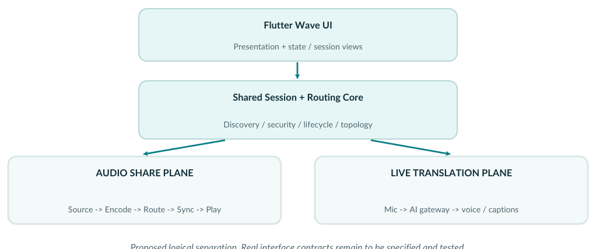

# Wave TRD — 03 Logical architecture and subsystems

**From:** `05_TRD_Wave_Technical_Requirements_Document_TRD_v1.0.pdf`  
**Pages:** 5, 6  
**Status:** Source working draft; no claim of implemented completion.

## 03 Logical architecture and subsystems

**Source diagram (page 5):** Logical system architecture

Flutter Wave UI

Presentation + state / session views

Shared Session + Routing Core

Discovery / security / lifecycle / topology

AUDIO SHARE PLANE

LIVE TRANSLATION PLANE

Source -> Encode -> Route -> Sync -> Play

Mic -> AI gateway -> voice / captions

Proposed logical separation. Real interface contracts remain to be specified and tested.

| Subsystem | Responsibility | Ownership / state |
| --- | --- | --- |
| Flutter UI | Navigation, approved Wave components, state displays, permissions guidance, user controls. | Client; UI only |
| Session coordinator | Room states, Host/Receiver membership, commands, QR/code invitations and lifecycle. | Client control; cloud authority for paid |
| Connectivity adapters | Wi-Fi LAN discovery and transport, hotspot guidance, Bluetooth sockets/relay. | Native Android / client |
| Local transport core | Authenticated session channels, framing, sequencing, delivery, retry and diagnostics. | Client data/control |
| Audio capture / media | Music/video media pipeline, eligible external playback capture, encoder, media controls. | Client; native Android |
| Sync engine | Clock estimates, playout scheduling, buffers, drift correction and late-frame policy. | Client with Host timeline |
| AI gateway | Authorized speaker audio ingest, translation stream orchestration, voice and captions fanout. | Internet backend |
| Identity / billing | Authentication, Host entitlement, usage reservations, ledger, quota and abuse enforcement. | Internet backend authority |
| Operations / QA | Metrics, compatibility test matrix, privacy-safe logs, cost and alarms. | Client/backend/testing |

### Recommended module boundaries (candidate, not existing code map)

| Flutter/Dart domain | Native/Backend interaction |
| --- | --- |
| features/audio_share/ | Host/Receiver UI; source status; sessions and local listening controls. |
| features/live_translation/ | Login/entitlement gating, language/speaker controls, captions and TTS output. |
| core/session/ | Session state machine, command events, join approval, persistence. |
| core/connectivity/ | TransportAdapter interface, link monitor, discovery and relay routing. |
| core/audio/ | Media session, encoder/decoder, clock mapping, SyncEngine. |
| core/security/ | Invite validation, ephemeral keys, peer authorization and token lifecycle. |
| backend/identity-session-billing/ | Authenticated hosted translation room, payee entitlement, usage ledger. |
| backend/ai-gateway/ | Streaming speech provider abstraction and per-language fanout. |
