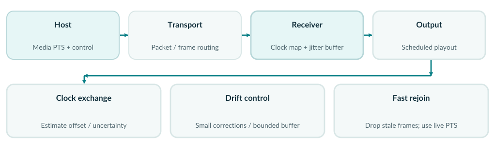

# Wave TRD — 07 Synchronization and buffering technical design

**From:** `05_TRD_Wave_Technical_Requirements_Document_TRD_v1.0.pdf`  
**Pages:** 9, 10  
**Status:** Source working draft; no claim of implemented completion.

## 07 Synchronization and buffering technical design

**Source diagram (page 9):** Playback timeline synchronization flow

Host

Transport

Receiver

Output

Media PTS + control

Packet / frame routing

Clock map + jitter buffer

Scheduled playout

Clock exchange

Drift control

Fast rejoin

Estimate offset / uncertainty

Small corrections / bounded buffer

Drop stale frames; use live PTS

### Clock and timeline model - proposed

- Each media stream carries source_stream_id, stream_epoch, sequence, capture_time or media PTS and a scheduled presentation time in a Host-defined monotonic timeline.

- Exchange periodic time probes to estimate Host-to-Receiver clock offset, network delay and uncertainty. Use 4-point time exchange where feasible; reject outlier delays.

- A simple offset estimate for a round trip is theta = ((t2 - t1) + (t3 - t4)) / 2, with t1/t4 measured on initiator and t2/t3 on remote; filter multiple samples.

- Receiver maps Host PTS to local monotonic time and schedules audio at an agreed target latency while maintaining bounded jitter buffer occupancy.

- At start/seek/source change, increment stream epoch and schedule a future playout start after adequate media pre-buffer is confirmed.

- Correct small drift through controlled buffer/clock adjustment or time stretching; for large desynchronization drop/reposition to current Host time rather than replay backlog.

- Output hardware latency differs by handset, speaker, USB and Bluetooth headphone route. Calibration/measurement is needed for end-to-end audible alignment.

### Transport policy

| Media type | Primary optimization | Failure response |
| --- | --- | --- |
| Music | Receiver-to-receiver timing quality with modest prebuffer. | Buffer/restart coordinated timeline; no uncontrolled backlog. |
| Host movie audio | Alignment with Host video frame timeline and other receivers. | Recalculate playout offset; synchronized pause/seek. |
| External-app audio | Minimal feasible end-to-end delay with bounded jitter. | Reduce buffer where stable; inform user of incompatibility/lag. |
| Multihop relay | Per-hop delay bound and duplicate/loop protection. | Reroute, adjust buffer or signal degraded delivery. |

### Metrics and evidence required before release

Instrument playout skew across Receivers, movie lip-sync offset, audio underrun count, jitter, network delay variance, late-frame rate, relay route-change recovery, drift corrections, CPU/battery and output-route effects. The previously discussed 10-20 ms receiver alignment is a research aspiration; choose release percentiles and environmental conditions from physical testing, not design assumption.
