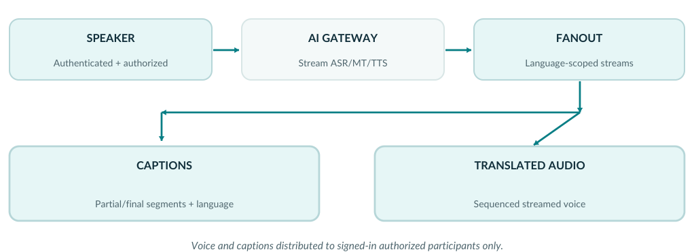

# Wave TRD — 08 Live Translation gateway and speech processing

**From:** `05_TRD_Wave_Technical_Requirements_Document_TRD_v1.0.pdf`  
**Pages:** 10, 11  
**Status:** Source working draft; no claim of implemented completion.

## 08 Live Translation gateway and speech processing

**Source diagram (page 10):** AI gateway and fan-out flow

SPEAKER

AI GATEWAY

FANOUT

Authenticated + authorized

Stream ASR/MT/TTS

Language-scoped streams

CAPTIONS

TRANSLATED AUDIO

Partial/final segments + language

Sequenced streamed voice

Voice and captions distributed to signed-in authorized participants only.

### Streaming processing pipeline - candidate design

- A signed-in and speaker-authorized participant sends short authenticated audio frames through the chosen local link to an internet-reachable translation gateway, usually the Host or a delegated approved bridge.

- Server verifies room, speaker rights, sponsoring Host entitlement, stream permissions and remaining budget before accepting billable work.

- Process input with streaming voice activity detection and/or direct speech-to-speech provider, recognition, language translation, speech synthesis, partial/final captions and segmentation. Provider topology is selectable after trials.

- Group authorized listeners by target language where possible; translate/synthesize a shared language stream once and fan it out to that group, subject to voice and personalization needs.

- Capture text/caption revisions and voice chunk sequence/timestamps so UI can distinguish tentative from final captions, avoid duplicate playback and recover from interruption.

- Model-generated voice is the initial approved direction; future personal-voice cloning requires explicit consent, security and cost/latency research.

- Handle timeouts, provider quota/exhaustion, unsupported languages, invalid speech, rate limiting and last valid caption/audio state explicitly.

### Transport / cloud dependency decision

Local Wi-Fi/hotspot/Bluetooth transport is not equivalent to an internet translation service. The gateway must reach the cloud AI provider. All Receivers also must authenticate; if they lack independent internet, a secure gateway-mediated account authentication protocol must be designed and approved. Do not silently downgrade to guests or skip verification.

### Translation voice/caption delivery contract

| Event | Minimum data and client behavior |
| --- | --- |
| speech.started | session_id, speaker_member_id, turn_id, source_language, server timestamp. |
| caption.partial | turn_id, target_language, revision, text, sequence, is_final=false; replace earlier partial. |
| caption.final | turn_id, target_language, revision, final text; accessibility announce as appropriate. |
| audio.chunk | turn_id, target_language, codec/format, sequence, playout hint and encrypted payload. |
| speech.ended | turn_id, final sequence/time; flush completed caption and audio safely. |
| translation.error | Error code, retryability, affected language/stream, quota/payer status. |

### Latency and accuracy

A 1-2 second continuous translated-speech experience is an early target, not an approved SLA; sub-500 ms is longer-term research. Measure end-of-utterance as well as speech onset, audio-to-audio latency, caption latency, truncation, recognition quality and translation accuracy using real Tamil/English samples and additional supported languages when approved.
