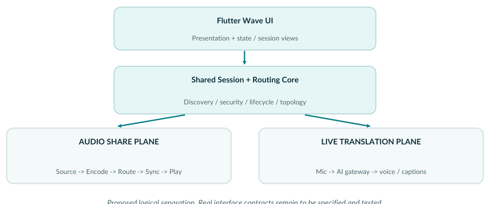
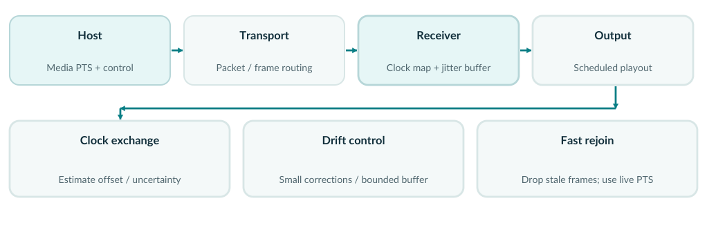
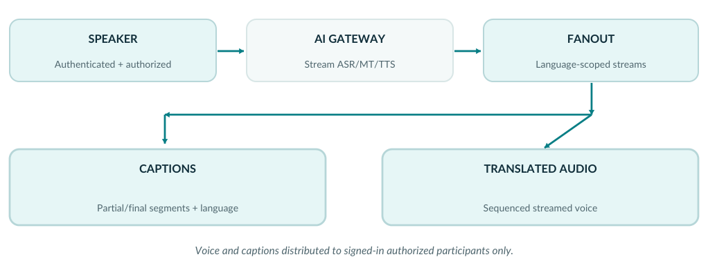

# Wave — Technical Requirements and Design Document

**Brand:** ZAEROX  
**Product:** Wave — Real-Time Translation & Multi-Device Audio Sharing  
**Source:** `05_TRD_Wave_Technical_Requirements_Document_TRD_v1.0.pdf`  
**Source version:** 1.0 (Working Draft, 16 November 2026)  
**Conversion:** Markdown transcription of source PDF; source status and unresolved decisions unchanged.

## Original cover details

> ZAEROX   /   PRODUCT DOCUMENTATION

> WAVE

> TECHNICAL REQUIREMENTS

> & DESIGN DOCUMENT

> Real-Time Translation &

> Multi-Device Audio Sharing

> DOCUMENT ID

> REVISION

> ISSUED

> ZAEROX-WAVE-TRD-001

> 1.0  /  DRAFT

> 16 NOV 2026

> Specification baseline for product, design, architecture and QA review

> Technical targets and proposed designs are not evidence of implemented features.

## 00 Document control

| Field | Details |
| --- | --- |
| Document | Technical Requirements & Design Document (TRD) |
| Product | Wave - Real-Time Translation & Multi-Device Audio Sharing |
| Brand / installed app name | ZAEROX / Wave |
| Reference | ZAEROX-WAVE-TRD-001 |
| Version / date | 1.0 / 16 November 2026 |
| Status | Working draft; product-owner approval and engineering verification outstanding |
| Audience | Product, design, Flutter / Android, backend, AI, QA, security and delivery teams |
| Linked baseline | Wave BRD v1.0; Audio Share UX V3.1 fixed decisions; approved project discussions |

### Purpose

The TRD translates the approved Wave business/product outcomes into a testable technical architecture and design baseline. It defines modules, data/control flows, security boundaries, candidate protocols, cloud translation processing, ledger controls, Android constraints and verification criteria. All items marked PROPOSED are design recommendations, not assertions that corresponding code is deployed.

Latest decision precedence: Live Translation requires signed-in accounts for all participants, including Host-paid Receivers. Basic Audio Share remains accessible without mandatory sign-in. No guest access to Live Translation. This supersedes earlier translation guest-join concepts.

### How to read the status language

| Status | Definition |
| --- | --- |
| LOCKED | Approved product / UX behavior; does not prove that implementation is finished. |
| TARGET | A product/engineering performance objective requiring measurable validation. |
| PROPOSED | Recommended implementation choice; not yet ratified or production deployed. |
| OPEN | A decision, threshold or behavior to finalize before a release commitment. |
| FUTURE | Deferred concept and not part of the present baseline. |

## 01 Contents and navigation

The following sections form the working requirement baseline. Section numbers are stable for review; final acceptance requires sign-off from the product owner and delivery team.

00 Document control

.  .  .  .  .  .  .  .  .  .  .  .  .  .  .  .  .  .  .  .  .  .  .  .  .  .  .  .  .  .  .  .  .  .  .  .  .  .  .  .  .  .  .  .  .  .  .  .  .  .  . 2

01 Contents and navigation

.  .  .  .  .  .  .  .  .  .  .  .  .  .  .  .  .  .  .  .  .  .  .  .  .  .  .  .  .  .  .  .  .  .  .  .  .  .  .  .  .  .  .  .  .  .  . 3

02 System objectives, boundaries and design principles

.  .  .  .  .  .  .  .  .  .  .  .  .  .  .  .  .  .  .  .  .  .  .  .  .  .  .  .  .  .  . 4

03 Logical architecture and subsystems

.  .  .  .  .  .  .  .  .  .  .  .  .  .  .  .  .  .  .  .  .  .  .  .  .  .  .  .  .  .  .  .  .  .  .  .  .  .  .  .  . 5

04 Session protocol, lifecycle and membership

.  .  .  .  .  .  .  .  .  .  .  .  .  .  .  .  .  .  .  .  .  .  .  .  .  .  .  .  .  .  .  .  .  .  .  .  . 6

05 Transport layer and discovery constraints

.  .  .  .  .  .  .  .  .  .  .  .  .  .  .  .  .  .  .  .  .  .  .  .  .  .  .  .  .  .  .  .  .  .  .  .  .  . 7

06 Media pipeline and Android-specific integration

.  .  .  .  .  .  .  .  .  .  .  .  .  .  .  .  .  .  .  .  .  .  .  .  .  .  .  .  .  .  .  .  .  . 8

07 Synchronization and buffering technical design

.  .  .  .  .  .  .  .  .  .  .  .  .  .  .  .  .  .  .  .  .  .  .  .  .  .  .  .  .  .  .  .  .  . 9

08 Live Translation gateway and speech processing

.  .  .  .  .  .  .  .  .  .  .  .  .  .  .  .  .  .  .  .  .  .  .  .  .  .  .  .  .  .  .  .  . 10

09 Identity, account access and speaker authorization

.  .  .  .  .  .  .  .  .  .  .  .  .  .  .  .  .  .  .  .  .  .  .  .  .  .  .  .  .  .  . 11

10 Billing, metering and spend-safety architecture

.  .  .  .  .  .  .  .  .  .  .  .  .  .  .  .  .  .  .  .  .  .  .  .  .  .  .  .  .  .  .  .  .  . 12

11 Data model and retention boundaries

.  .  .  .  .  .  .  .  .  .  .  .  .  .  .  .  .  .  .  .  .  .  .  .  .  .  .  .  .  .  .  .  .  .  .  .  .  .  . 13

12 Candidate network and backend interfaces

.  .  .  .  .  .  .  .  .  .  .  .  .  .  .  .  .  .  .  .  .  .  .  .  .  .  .  .  .  .  .  .  .  .  .  . 14

13 Error handling, recovery and resilience design

.  .  .  .  .  .  .  .  .  .  .  .  .  .  .  .  .  .  .  .  .  .  .  .  .  .  .  .  .  .  .  .  .  . 14

14 Security and compliance release requirements

.  .  .  .  .  .  .  .  .  .  .  .  .  .  .  .  .  .  .  .  .  .  .  .  .  .  .  .  .  .  .  .  .  . 15

15 Observability, benchmarks and acceptance evidence

.  .  .  .  .  .  .  .  .  .  .  .  .  .  .  .  .  .  .  .  .  .  .  .  .  .  .  .  .  . 15

16 Performance budgets and operational constraints

.  .  .  .  .  .  .  .  .  .  .  .  .  .  .  .  .  .  .  .  .  .  .  .  .  .  .  .  .  .  .  . 17

17 Engineering rollout and decision gates

.  .  .  .  .  .  .  .  .  .  .  .  .  .  .  .  .  .  .  .  .  .  .  .  .  .  .  .  .  .  .  .  .  .  .  .  .  .  . 17

18 Traceability and authoritative references

.  .  .  .  .  .  .  .  .  .  .  .  .  .  .  .  .  .  .  .  .  .  .  .  .  .  .  .  .  .  .  .  .  .  .  .  . 18

Document note: this file describes the desired product/system, not a source-code audit certificate. Any explicit device capacity, performance threshold, API vendor or payment price must be approved and verified separately.

## 02 System objectives, boundaries and design principles

Wave is a Flutter Android application with native Android responsibilities for connectivity, media capture/playback and foreground services. The system supports two distinct data paths: an offline-capable local Audio Share plane, and an internet-dependent AI translation plane. A shared session/core routing layer governs both services, but authentication and billing rules differ.

### Architecture principles

- Preserve product navigation and all latest locked UI decisions; build modules behind stable product contracts rather than replacing screens.

- Explicitly distinguish control plane (join, permissions, session states, commands) from media/data plane (encoded audio frames, translation voice segments, captions).

- All transport-specific operations must be behind interchangeable interfaces; do not assume Wi-Fi, hotspot and Bluetooth have equal capacity/latency.

- Use authoritative server-side enforcement for paid translation access and usage; never trust client-side balances or role assertions.

- Use monotonic clocks and timestamps for sync, independent of wall-clock changes; recognize output-device latency.

- Make recovery idempotent: reconnecting must not create duplicate billable sessions, double-charge or replay stale media.

- Fail visibly and securely when an Android restriction, cloud dependency or hardware limit cannot be satisfied.

Source-of-truth precedence: 16 Nov 2026 Live Translation all-account sign-in supersedes earlier guest-translation proposals. Audio Share remains guest-accessible. All users still select transport first, role second, and then Create/Join; sign-in occurs in context of translation branches.

### Technical non-goals

No fabricated guarantee of unlimited Bluetooth hops or peers; no Receiver video streaming; no microphone Audio Share source; no bypass of Android content-capture policy; no full offline AI translation; no production claim for a selected AI vendor, billing provider, storage backend or exact codec until verified.

## 03 Logical architecture and subsystems

**Source diagram (page 5):** Logical system architecture

Flutter Wave UI

Presentation + state / session views

Shared Session + Routing Core

Discovery / security / lifecycle / topology

AUDIO SHARE PLANE

LIVE TRANSLATION PLANE

Source -> Encode -> Route -> Sync -> Play

Mic -> AI gateway -> voice / captions

Proposed logical separation. Real interface contracts remain to be specified and tested.

| Subsystem | Responsibility | Ownership / state |
| --- | --- | --- |
| Flutter UI | Navigation, approved Wave components, state displays, permissions guidance, user controls. | Client; UI only |
| Session coordinator | Room states, Host/Receiver membership, commands, QR/code invitations and lifecycle. | Client control; cloud authority for paid |
| Connectivity adapters | Wi-Fi LAN discovery and transport, hotspot guidance, Bluetooth sockets/relay. | Native Android / client |
| Local transport core | Authenticated session channels, framing, sequencing, delivery, retry and diagnostics. | Client data/control |
| Audio capture / media | Music/video media pipeline, eligible external playback capture, encoder, media controls. | Client; native Android |
| Sync engine | Clock estimates, playout scheduling, buffers, drift correction and late-frame policy. | Client with Host timeline |
| AI gateway | Authorized speaker audio ingest, translation stream orchestration, voice and captions fanout. | Internet backend |
| Identity / billing | Authentication, Host entitlement, usage reservations, ledger, quota and abuse enforcement. | Internet backend authority |
| Operations / QA | Metrics, compatibility test matrix, privacy-safe logs, cost and alarms. | Client/backend/testing |

### Recommended module boundaries (candidate, not existing code map)

| Flutter/Dart domain | Native/Backend interaction |
| --- | --- |
| features/audio_share/ | Host/Receiver UI; source status; sessions and local listening controls. |
| features/live_translation/ | Login/entitlement gating, language/speaker controls, captions and TTS output. |
| core/session/ | Session state machine, command events, join approval, persistence. |
| core/connectivity/ | TransportAdapter interface, link monitor, discovery and relay routing. |
| core/audio/ | Media session, encoder/decoder, clock mapping, SyncEngine. |
| core/security/ | Invite validation, ephemeral keys, peer authorization and token lifecycle. |
| backend/identity-session-billing/ | Authenticated hosted translation room, payee entitlement, usage ledger. |
| backend/ai-gateway/ | Streaming speech provider abstraction and per-language fanout. |

## 04 Session protocol, lifecycle and membership

### Canonical session state machine

| State | Entry / possible transitions | Required invariant |
| --- | --- | --- |
| CREATING | Local room setup -> LOBBY or ERROR. | Session ID generated once; no media playback before valid setup. |
| LOBBY | Accept new members -> READY/ENDED. | Invite valid; approval and capacity enforcement. |
| READY | Start complete, source not selected -> LIVE/PAUSED/ENDED. | Session alive; no false Sharing status. |
| LIVE | Source available -> PAUSED/RECONNECTING/ENDED. | Host timeline authoritative; audio routed to admitted members. |
| PAUSED | Host pause or movie view exit -> LIVE/ENDED. | Connections/room remain active; no movie audio sent. |
| RECONNECTING | Transport lost -> prior state/ERROR/ENDED. | Same session identity and replay protection. |
| ENDED | Host end or expiry -> History. | No automatic resume; tokens revoked and media stopped. |

### Membership and role invariants

- Host owns session configuration, room approval, media control and global End. A Receiver can change only their own output state and may be promoted to an authorized translation speaker.

- Relay status is a dynamically assigned transport responsibility; never assign it as a separate UI registration role.

- Room codes and QR payloads identify/locate the session but cannot grant access alone. Host-only approval setting is distinct from cryptographic/admission validation.

- Use unique session_id, member_id, device_instance_id, participant role and membership version/epoch to reject stale memberships and duplicate joins.

- Define idempotent join and command IDs; retries should not create duplicate participants, sessions, ledger entries or playback actions.

### Proposed session message envelope

| Field | Semantics |
| --- | --- |
| protocol_version | Semantic major/minor; reject incompatible major with helpful response. |
| session_id / member_id | Cryptographically unpredictable session identifier and current authorized sender identity. |
| epoch / sequence | Monotonic room generation and sender sequence to detect replay/reordering. |
| message_type | JOIN_REQUEST, JOIN_ACCEPT, APPROVAL, SYNC, PLAY, PAUSE, SEEK, SOURCE, LEAVE, END, etc. |
| issued_at / expires_at | Clock/context-aware expiry; never rely on remote wall-clock alone for media playout. |
| payload / auth_tag | Typed encoded body and integrity protection using session keys. |

## 05 Transport layer and discovery constraints

| Transport | Proposed technical path | Critical limitations / checks |
| --- | --- | --- |
| Shared Wi-Fi | Authenticated LAN discovery, secure client-server or peer forwarding; scalable fanout based on measured capacity. | AP isolation, multicast/UDP availability, latency, network change and router policies. |
| Host hotspot | Host guides Android tethering configuration; receivers join network via system UI; local sockets. | OEM device limits, hotspot+mobile-data behavior, Android hotspot control restrictions. |
| Bluetooth Classic | App-level RFCOMM/socket channels for negotiated audio/control framing; direct and relay experiments. | Practical throughput, simultaneous link limits, codec overhead, discovery and connection stability. |
| Wi-Fi Direct | Candidate low-level future adapter, not a user-facing fourth network choice. | Group ownership, coexistence, versions and hardware availability. |
| Cross-network cloud | Deliberately excluded from core room discovery/media requirement. | Do not make public-internet remote rooms an implicit dependency of local Audio Share. |

### TransportAdapter proposal

Define an interface with scan/discover, connect, authenticateLink, sendControl, sendMedia, subscribeEvents, getMetrics and close. Each adapter declares media MTU/frame size, estimated throughput, link latency, peer count, congestion signals and whether reliable/unreliable delivery is available.

### Topology and local route planning

- Maintain a route graph keyed by device/session IDs, with link quality, hop count, freshness and selected route. Distinguish direct Receiver from Receiver-with-relay-function.

- Use bounded time-to-live/hop-limit and deduplication (session_id + source_stream_id + sequence) to prevent loops and re-broadcast storms.

- Prefer stable routes over constant topology churn; route updates require authentication and monotonic epoch/version.

- On relay loss, attempt bounded alternative routing with jitter-buffer protection; if unavailable, mark Reconnecting and ask for relevant user action.

- Never assume Bluetooth mesh can scale unboundedly or that relay forwarding is possible under background restrictions.

## 06 Media pipeline and Android-specific integration

### Audio Share media path

Source (music/video/external capture) -> audio decode/mix as applicable -> encode into transport-appropriate frames -> timestamp/sequence -> authenticated media transport -> receiver jitter buffer/Sync Engine -> decoder -> audio output. Preserve session and media-state identifiers when changing sources.

### Media import / playback

- Local music and movie selectors rely on Android-supported document/media access and content URIs; manage user-granted access rather than assuming raw filesystem access.

- Host movie renders only on Host. Extract/transmit only movie audio to Receivers. Seek, play and pause update the current source timeline and sync epochs.

- On Host movie player exit or lock, pause both video and shared movie audio but keep session/membership active; require explicit Host resume.

- Music should continue in supported background conditions using Android-compliant playback service behavior; verify Doze, audio focus and vendor battery limits.

- Codec choice, sample rate, channels, bitrate and frame size are engineering decisions tied to device/transport tests, not preapproved fixed values.

### External-app playback capture restrictions

Android AudioPlaybackCaptureConfiguration only captures eligible audio usages when the source app/player permits playback capture and required user authorization is obtained. Treat permission denial, source opt-out, stopped projection and silence as distinct states. Use MediaProjection/playback capture only within supported Android APIs, never bypass app capture policy. [A1, A2]

### Foreground and microphone services

Declare Android foreground-service types and permissions appropriate to real use (mediaPlayback, mediaProjection, microphone, connectedDevice as applicable). Android 14+ foreground-service and while-in-use microphone rules restrict launch conditions. Plan consent, notifications, audio focus and cleanup around those OS constraints; do not assume microphone recording can begin or continue silently from background. [A3, A4]

| Android concern | Required test / implementation response |
| --- | --- |
| MediaProjection consent | Request on the applicable source path; show Capturing/Denied/Stopped states. |
| Source opted out | Return Unsupported/No capturable audio; do not retry as if temporarily broken. |
| Foreground service | Visible playback/translation indicators and correct service types across target OS levels. |
| Background execution | Verify screen-off, app switch, Doze, audio focus, OEM killing and process recreation. |
| Output route change | Handle wired/Bluetooth headphone routes, focus and latency recalibration. |
| Transport permissions | Use contextual Bluetooth/nearby/network/system prompts and revalidate after return. |

## 07 Synchronization and buffering technical design

**Source diagram (page 9):** Playback timeline synchronization flow

Host

Transport

Receiver

Output

Media PTS + control

Packet / frame routing

Clock map + jitter buffer

Scheduled playout

Clock exchange

Drift control

Fast rejoin

Estimate offset / uncertainty

Small corrections / bounded buffer

Drop stale frames; use live PTS

### Clock and timeline model - proposed

- Each media stream carries source_stream_id, stream_epoch, sequence, capture_time or media PTS and a scheduled presentation time in a Host-defined monotonic timeline.

- Exchange periodic time probes to estimate Host-to-Receiver clock offset, network delay and uncertainty. Use 4-point time exchange where feasible; reject outlier delays.

- A simple offset estimate for a round trip is theta = ((t2 - t1) + (t3 - t4)) / 2, with t1/t4 measured on initiator and t2/t3 on remote; filter multiple samples.

- Receiver maps Host PTS to local monotonic time and schedules audio at an agreed target latency while maintaining bounded jitter buffer occupancy.

- At start/seek/source change, increment stream epoch and schedule a future playout start after adequate media pre-buffer is confirmed.

- Correct small drift through controlled buffer/clock adjustment or time stretching; for large desynchronization drop/reposition to current Host time rather than replay backlog.

- Output hardware latency differs by handset, speaker, USB and Bluetooth headphone route. Calibration/measurement is needed for end-to-end audible alignment.

### Transport policy

| Media type | Primary optimization | Failure response |
| --- | --- | --- |
| Music | Receiver-to-receiver timing quality with modest prebuffer. | Buffer/restart coordinated timeline; no uncontrolled backlog. |
| Host movie audio | Alignment with Host video frame timeline and other receivers. | Recalculate playout offset; synchronized pause/seek. |
| External-app audio | Minimal feasible end-to-end delay with bounded jitter. | Reduce buffer where stable; inform user of incompatibility/lag. |
| Multihop relay | Per-hop delay bound and duplicate/loop protection. | Reroute, adjust buffer or signal degraded delivery. |

### Metrics and evidence required before release

Instrument playout skew across Receivers, movie lip-sync offset, audio underrun count, jitter, network delay variance, late-frame rate, relay route-change recovery, drift corrections, CPU/battery and output-route effects. The previously discussed 10-20 ms receiver alignment is a research aspiration; choose release percentiles and environmental conditions from physical testing, not design assumption.

## 08 Live Translation gateway and speech processing

**Source diagram (page 10):** AI gateway and fan-out flow

SPEAKER

AI GATEWAY

FANOUT

Authenticated + authorized

Stream ASR/MT/TTS

Language-scoped streams

CAPTIONS

TRANSLATED AUDIO

Partial/final segments + language

Sequenced streamed voice

Voice and captions distributed to signed-in authorized participants only.

### Streaming processing pipeline - candidate design

- A signed-in and speaker-authorized participant sends short authenticated audio frames through the chosen local link to an internet-reachable translation gateway, usually the Host or a delegated approved bridge.

- Server verifies room, speaker rights, sponsoring Host entitlement, stream permissions and remaining budget before accepting billable work.

- Process input with streaming voice activity detection and/or direct speech-to-speech provider, recognition, language translation, speech synthesis, partial/final captions and segmentation. Provider topology is selectable after trials.

- Group authorized listeners by target language where possible; translate/synthesize a shared language stream once and fan it out to that group, subject to voice and personalization needs.

- Capture text/caption revisions and voice chunk sequence/timestamps so UI can distinguish tentative from final captions, avoid duplicate playback and recover from interruption.

- Model-generated voice is the initial approved direction; future personal-voice cloning requires explicit consent, security and cost/latency research.

- Handle timeouts, provider quota/exhaustion, unsupported languages, invalid speech, rate limiting and last valid caption/audio state explicitly.

### Transport / cloud dependency decision

Local Wi-Fi/hotspot/Bluetooth transport is not equivalent to an internet translation service. The gateway must reach the cloud AI provider. All Receivers also must authenticate; if they lack independent internet, a secure gateway-mediated account authentication protocol must be designed and approved. Do not silently downgrade to guests or skip verification.

### Translation voice/caption delivery contract

| Event | Minimum data and client behavior |
| --- | --- |
| speech.started | session_id, speaker_member_id, turn_id, source_language, server timestamp. |
| caption.partial | turn_id, target_language, revision, text, sequence, is_final=false; replace earlier partial. |
| caption.final | turn_id, target_language, revision, final text; accessibility announce as appropriate. |
| audio.chunk | turn_id, target_language, codec/format, sequence, playout hint and encrypted payload. |
| speech.ended | turn_id, final sequence/time; flush completed caption and audio safely. |
| translation.error | Error code, retryability, affected language/stream, quota/payer status. |

### Latency and accuracy

A 1-2 second continuous translated-speech experience is an early target, not an approved SLA; sub-500 ms is longer-term research. Measure end-of-utterance as well as speech onset, audio-to-audio latency, caption latency, truncation, recognition quality and translation accuracy using real Tamil/English samples and additional supported languages when approved.

## 09 Identity, account access and speaker authorization

### Authentication rules

| Flow | Enforced by | Technical requirement |
| --- | --- | --- |
| Basic Audio Share | Local session coordinator | No mandatory account. Still require secure local room admission and revocable membership. |
| Translation Host | Identity and entitlement backend | Verified account before creating/starting billable session. |
| Translation Receiver | Identity backend + session gateway | Verified account before join, including Host-paid sponsored access. |
| Authorized speaker | Session owner policy + backend | Host permits microphone upload; server rejects unauthorized speaker frames. |

### Proposed auth/token lifecycle

- Use a supported authentication provider and server-verifiable access tokens; exact provider and required registration fields are open product decisions.

- Use short-lived, session-scoped join credentials with audience, session, user, membership, role, expiry and revocation semantics.

- Refresh/re-authenticate according to provider policy without implicitly admitting signed-out users. Host transfer/owner election is out of scope until formally designed.

- Do not use room code, QR content, nickname or Bluetooth pairing alone as translation account authentication.

- Credential/device compromise and banned/removed participants must revoke access to media, speaker controls and paid AI processing.

### Threat model highlights

| Threat | Required defense |
| --- | --- |
| Forged room/speaker | Authenticated membership and Host-authorized speaker grants. |
| Replay/old packets | Session key, epoch, nonce/counter, replay window and command version. |
| Unauthorized host billing | Backend entitlement, sponsor-bound claims and per-event rate checks. |
| Guest translation bypass | Server rejects unauthenticated Receiver even when Host sponsors. |
| Session/link eavesdropping | Encryption of audio/control packets and secure handshake; keys scoped to session. |
| Room-code guessing | Rate limiting, expiry and handshake beyond short code. |

## 10 Billing, metering and spend-safety architecture

### Source of financial truth

The backend, not a Flutter screen or Host packet, must decide whether AI work can be initiated and how usage is charged. Sponsor ownership is bound to a signed-in Host session. All authorized Receiver speaking costs belong to that Host under the locked Host-paid model.

### Proposed usage event/ledger design

| Field | Purpose |
| --- | --- |
| usage_event_id | Unique idempotency key from provider/job/event lifecycle. |
| session_id / sponsor_user_id | Immutable attribution to Host-sponsored session and payer. |
| speaker_user_id / target_language | Auditable authorized speaker and target stream. |
| unit_type / units | Provider-aligned measure (seconds, tokens, requests or credits); exact policy open. |
| estimated_cost / actual_cost | Reconcile preauthorization with provider-reported final billable units. |
| reserved / committed / voided | Reservation state so concurrent requests cannot overdraw budget. |
| provider_reference / occurred_at | Reference for reconciliation and dispute/audit with privacy minimization. |

### Billing control flow

- Before dispatch: verify Host active entitlement, session active, speaker authorized and available spend; reserve an estimated bounded budget atomically.

- During stream: enforce time/usage ceilings and limits per session, host, speaker and language; stop or deny new provider work before overrun.

- After billable work: reconcile actual provider usage, commit ledger once and release unused reservation; retry/failure must not double-charge.

- For exhaustion/provider failure: stop chargeable translation cleanly, notify Host/Receivers and preserve local non-billable session control as applicable.

- Never hardcode speculative per-minute rates in client UI. Use server-configured pricing/credits after business/legal approval.

### Financial observability

Track sponsor quota/balance, reserved spend, actual provider cost, minutes per source/target language, cost per successful translation minute, unusual concurrency and reconciliation delta. Billing must remain auditable without retaining unnecessary raw speech/audio.

## 11 Data model and retention boundaries

| Logical entity | Key fields (proposed) | Retention / control |
| --- | --- | --- |
| Account | user_id, verified identity provider, language preference, account state. | Mandatory for translation; fields/retention pending. |
| Session | session_id, type, Host ID, method, lifecycle state, created/ended time, approval policy. | Active + permitted limited history. |
| Membership | member_id, session_id, verified account ID when translation, role, state, authorization epoch. | Revocable; guest temporary ID for Audio Share. |
| Audio source | source_id/epoch, media type, duration/metadata, capture eligibility status. | Avoid storing private media by default. |
| Translation turn | turn_id, speaker, target groups, language and status. | Metadata only by default; transcript policy open. |
| Entitlement | sponsor_user_id, plan/quota, valid period, billing rules. | Backend only; immutable financial events. |
| Usage ledger | usage_event_id, sponsor, unit, provider ref, reservation/commit state. | Auditable financial retention, policy pending. |
| Diagnostics | timing, loss, OS/device versions, redacted error codes. | Time-limited and privacy-minimized. |

### Data protection constraints

- Prefer ephemeral handling of raw audio and speech segments. Do not store recordings or transcripts unless policy, notice, consent and explicit use cases require it.

- Encrypt transport and backend data; minimize logs, remove room codes/tokens/PII; ensure account controls and consent flows can be audited.

- Protect financial/event integrity with append-only ledger semantics, role-based admin rights and controlled retention.

- Define subject-data deletion, backups, retention periods, region compliance and consent wording before production release.

## 12 Candidate network and backend interfaces

### API surface (illustrative; not deployed endpoints)

| Interface | Method / event | Responsibility |
| --- | --- | --- |
| /v1/identity/session | POST | Create or refresh authenticated account/session token via chosen identity service. |
| /v1/translation/sessions | POST | Create sponsored translation session after entitlement authorization. |
| /v1/translation/sessions/{id}/join | POST | Join authenticated account; validate room and approval policy. |
| /v1/translation/sessions/{id}/speakers | PATCH | Grant/revoke speaker rights with Host-bound authorization. |
| /v1/translation/sessions/{id}/usage | GET | Read server-calculated Host budget/usage summary. |
| /v1/translation/stream | WebSocket / WebRTC candidate | Send authorized speech audio; deliver language-scoped voice/caption events. |
| Local PeerChannel | Encrypted local socket | Transport-independent JOIN, SYNC, PLAY, PAUSE, SEEK, SOURCE, MEDIA, LEAVE, END. |

### Contract requirements

- Every sensitive backend method requires server-verifiable identity, session-scoped authorization and idempotency where applicable.

- Use versioned payload schemas and explicit error codes: UNAUTHENTICATED, NOT_ENTITLED, NOT_ADMITTED, NOT_SPEAKER, QUOTA_EXCEEDED, SESSION_ENDED, UNSUPPORTED_LANGUAGE, TRANSPORT_UNAVAILABLE.

- Never expose AI provider secrets or payment credentials in Flutter code, QR payloads or logs.

- Choose transport technology (streaming WebSocket/WebRTC/UDP/local sockets) after comparing delay, reconnect semantics, security and resource cost on target devices.

## 13 Error handling, recovery and resilience design

| Failure | Recovery / invariant | Verification |
| --- | --- | --- |
| Receiver network loss | Try existing room credentials and route recovery; preserve session ID, revalidate membership. | Forced disconnect per method. |
| Relay offline | Recompute alternate path with TTL/deduplication; avoid packet loop. | Kill relay mid-stream. |
| Host paused movie | Send pause/epoch control; connections alive, no stale audio. | Lock Host during video. |
| Host process killed | Do not claim automatic continuation; apply approved ownership policy when defined. | OEM background / process death. |
| Source file unavailable | Pause/stop relevant media; preserve room state and report source missing. | Revoke document permission. |

| Failure | Recovery / invariant | Verification |
| --- | --- | --- |
| Cloud/provider unreachable | Stop fresh chargeable work; retain verified last states, retry safely. | Server connection drop. |
| Billing reservation race | Atomic reserve/commit; enforce budget under concurrent speakers. | Simultaneous speech load. |
| Auth token expires | Refresh as permitted; block unauthorized voice/paid work on expiry. | Forced token invalidation. |
| Playback clock drift | Correct gradual drift or resync at current live PTS without replaying old frames. | Long-running two/three-device test. |

## 14 Security and compliance release requirements

### Security baseline

- Authenticated host/session and all-user translation membership, signed/expiring invites, admission control and revocation.

- Secure authenticated encryption for local media/control where feasible, key rotation/rekey on membership change and cryptographic design review prior to launch.

- HTTPS/TLS to cloud services; store tokens in platform-appropriate secure storage; never distribute private API keys in apps.

- Host actions and speaker permissions authorized server-side for paid sessions; no client-supplied charge ownership override.

- API rate limiting, safe error disclosures, replay protection, invite brute-force controls and privacy-safe security logs.

- Media rights/compliance review for importing and transmitting locally accessed content; third-party protected playback capture remains subject to source-app/system policy.

### Privacy and user transparency

The final policy must specify microphone use, speech transfer to cloud AI, participants who may hear voice/captions, whether transcripts or recordings persist, account deletion and billing records retention. Jurisdiction-specific legal evaluation remains a release gate, not something assumed satisfied by this draft.

## 15 Observability, benchmarks and acceptance evidence

### Proposed metrics

| Domain | Metrics to collect | Method |
| --- | --- | --- |
| Local transport | Peer count, reconnects, throughput, RSSI where available, jitter/loss, route/hops. | Device log and captured test metrics. |
| Audio sync | Receiver audible skew, Host video lip-sync offset, drift, underruns, late frames. | Multichannel recording / synced reference. |
| Live Translation | Speech onset -> caption partial/final, speech onset -> voice, accuracy and interruption. | Timed bilingual corpus and user studies. |
| Billing | Reserved/committed provider units, Host credit spend, quota denial, duplicate-charge rate. | Ledger/provider reconciliations. |
| Android lifecycle | Background starts/stops, permission errors, service lifetime, battery drain. | OEM/OS matrix, profiler, logcat. |
| UX/accessibility | Successful joins, denied/timeout recovery, screen reader, scaling/contrast. | Scripted UI and device tests. |

### Scenario-based test matrix

| ID | Required test | Expected proof |
| --- | --- | --- |
| T-01 | Guest Audio Share Wi-Fi and hotspot joins, Host approval ON/OFF. | Successful validated join and independent leave. |
| T-02 | Bluetooth direct and multi-hop at increasing relay depth. | Actual topology, loss, delay and fallback logs; no hard capacity promise. |
| T-03 | Music/video sync across different device models and output routes. | Documented offset distribution and drift/resync results. |
| T-04 | Host video lock/exits; Receiver pause/resume while acting as relay. | Movie audio stops; independent local pause with forwarding sustained. |
| T-05 | External playback capture allowed vs opted-out source. | Consent and policy compliance; truthful error states. |
| T-06 | All translation users must sign in, even with Host sponsor. | Rejected unauthenticated requests at UI AND backend. |
| T-07 | Translation with 2+ target languages and authorized Receiver speaking. | Correct separate voice/caption streams and attribution. |
| T-08 | Provider timeout, loss of gateway internet, quota exhaustion. | Safe halt, no unauthorized spend, clear user messaging. |
| T-09 | Simultaneous billable work, retries, duplicate callback events. | Exactly-once ledger commit semantics from idempotent events. |
| T-10 | Foreground/background/Doze/OEM battery policies and Android accessibility. | Measured compatibility matrix and unresolved exceptions. |

### What does NOT constitute sufficient evidence

A working prototype demo alone does not establish transport coverage, fanout scale, AI correctness, secure billing, compatibility or a production-grade Sync Engine. Release claims require repeatable tests, actual device identifiers, test setup and thresholds approved in advance.

## 16 Performance budgets and operational constraints

| Metric / objective | Current planning position | Acceptance state |
| --- | --- | --- |
| Receiver synchronization | 10-20 ms alignment was discussed as an ambitious target. | Not measured/approved as SLA. |
| Translated voice latency | Approximately 1-2 seconds initially; <500 ms future research. | Target only; percentile/conditions OPEN. |
| Group participant capacity | 2/4-phone prototypes exist; 10-20 and 50-100 discussed for research. | Not promised; verify separately per transport. |
| Bluetooth hops / routes | Dynamic multi-hop and self-healing routing are product goals. | Physical feasibility and limits OPEN. |
| Music background / video pause | Background music required; video/audio pause on Host view exit. | Functional requirement; OS tests required. |
| AI cost efficiency | Share target-language processing where possible; bill using actual units. | Architecture proposal; provider economics OPEN. |
| Battery and bandwidth | Instrument and optimize per transport/device. | Numerical release thresholds OPEN. |

## 17 Engineering rollout and decision gates

| Gate | Deliverables / check | Approval owner |
| --- | --- | --- |
| G0 - Design review | Spec-to-code map, security/dataflow threat model, API/provider decision options. | Engineering + product |
| G1 - Local transport proof | Wi-Fi/hotspot/BT direct test reports; initial route and auth proof. | Engineering + QA |
| G2 - Sync qualification | Clock/drift tests, music/movie/receiver pause behavior, output routes. | Audio engineering + QA |
| G3 - Account / AI beta | All participant sign-in, Host-funded verification, live translated voice/captions. | Product + AI + backend |
| G4 - Billing safety | Server metering/quotas, consent, ledger reconciliation, concurrency/race tests. | Backend + security + finance |
| G5 - Release readiness | App lifecycle/OEM compatibility, privacy policy, accessible UX, capacity and SLA claims based on tests. | Product owner + QA |

### Open technical decisions

| ID | Unresolved specification |
| --- | --- |
| TD-01 | Minimum/target Android SDK versions, device/OEM compatibility and Bluetooth coexistence matrix. |
| TD-02 | Media codec(s), framing interval, discovery scheme and secure link key exchange per transport. |
| TD-03 | Relay graph protocol, routing metric, allowed fanout/hops, self-healing and method migration policy. |
| TD-04 | Sync playout latency budgets, output-route calibration and measured skew percentiles. |
| TD-05 | Selected AI provider/API, language support, latency, failover, cloud hosting and geographic processing regions. |
| TD-06 | Identity provider, account fields, authenticated joining over Host-only internet connection. |
| TD-07 | Pricing/credit unit specification, provider usage reconciliation, quotas and payment provider. |
| TD-08 | Session host loss, explicit handover rules, app restart and persistent history semantics. |
| TD-09 | Data retention, recordings/transcript policy, privacy notices, deletion/backup. |
| TD-10 | Release targets and QA coverage for battery, network quality, accessibility, sync and fanout. |

## 18 Traceability and authoritative references

### Requirement coverage

| PRD area | TRD technical response |
| --- | --- |
| PR-AS-01..10; PR-AR-01..07 | Sections 04-07, 13 and 15 - state, source, relay, sync, reception and recovery. |
| PR-SE-01..05 | Sections 04-05, 13 - lifecycle and session persistence. |
| PR-LT-01..10 | Sections 08-09, 12 - speech processing, signed-in membership and streaming. |
| PR-BI-01..06 | Sections 09-11 - backend entitlement, payment safety and retention. |
| PR-NF-01..09; AC-01..12 | Sections 14-17 - security, quality metrics, Android compliance and verification. |

### Project sources

| Reference | Role |
| --- | --- |
| Wave BRD v1.0 (16 Nov 2026) | Business rules and priorities; latest all-user translation sign-in is authoritative. |
| Wave PRD v1.0 (companion document) | Locked user journeys, behaviors, UX inventory and acceptance criteria. |
| WAVE Audio Share UX V3.1 Fixed Decisions | Approved role-aware checks, screen inventory, video pause and local receiver control. |
| Wave prototype history / V5.1 source archives | Baseline implementations exist, but no fresh build/unit/device validation was performed for this TRD. |

### Android official technical references (reviewed for constraints)

| Ref | Official reference |
| --- | --- |
| A1 | Android AudioPlaybackCaptureConfiguration - https://developer.android.com/reference/android/media/AudioPlaybackCaptureConfiguration |
| A2 | Android capture video and playback audio - https://developer.android.com/media/platform/av-capture |
| A3 | Android 14 required foreground-service types - https://developer.android.com/about/versions/14/changes/fgs-types-required |
| A4 | Foreground service background-start / while-in-use restrictions - https://developer.android.com/develop/background-work/services/fgs/restrictions-bg-start |
| A5 | Android Bluetooth overview / RFCOMM - https://developer.android.com/develop/connectivity/bluetooth |

Specification status: This is a complete proposed technical baseline, not a certificate that the current Flutter source implements these modules/APIs. Final transport protocols, cloud stack, encryption design, performance SLAs and provider billing contracts must be approved, built and tested.
